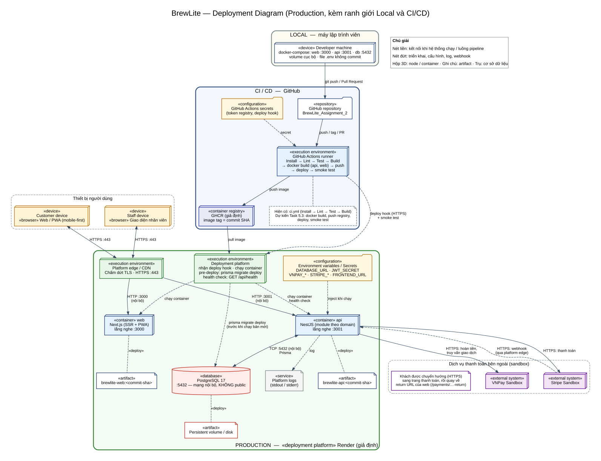

# Deployment Diagram — BrewLite (Task 3.2)

Sơ đồ triển khai UML của môi trường **production**, rà lại theo kiến trúc Task 3.1 ([`system-architecture.md`](./system-architecture.md), mục 8) và phương án đã chọn: **Render** (nền tảng triển khai) + **GHCR** (container registry). Sơ đồ có ranh giới **Local**, **CI/CD (GitHub)** và **Production (Render)**.

| Tệp | Vai trò |
| --- | --- |
| `deployment-diagram.dot` | Mã nguồn sơ đồ (Graphviz) |
| `deployment-diagram.svg` | Ảnh vector, dùng chèn vào tài liệu |
| `deployment-diagram.png` | Ảnh 110 dpi, dùng cho slide hoặc báo cáo Word |

Tạo lại ảnh sau khi sửa `.dot` (cần [Graphviz](https://graphviz.org/download/)):

```bash
dot -Tsvg deployment-diagram.dot -o deployment-diagram.svg
dot -Tpng -Gdpi=110 deployment-diagram.dot -o deployment-diagram.png
```



## 0. Quy ước: phần nào đã có, phần nào là cấu hình đích

Trên sơ đồ, **viền liền** là thứ đã có trong repository và đã được kiểm tra. **Viền đứt kèm nhãn «ĐÍCH S2»** là cấu hình đích: chưa tồn tại ở thời điểm Task 3.2, Sprint 2 (Task 5.3 và 5.4) sẽ triển khai và kiểm chứng. Hiện chưa có dịch vụ Render, image GHCR hay workflow deploy nào; không được trình bày các phần «ĐÍCH S2» là đã chạy.

| Trạng thái | Thành phần |
| --- | --- |
| **Đã có** (kiểm chứng trong repo) | `apps/web/Dockerfile`, `apps/api/Dockerfile`, `docker-compose.yml` (frontend, backend, db), `.github/workflows/ci.yml`, `apps/api/prisma/migrations/`, `GET /api/health` và `GET /api/health/ready` (`apps/api/src/health/`), `.env.example` (chỉ tên biến), đọc `PORT`, `DATABASE_URL`, `FRONTEND_URL` từ môi trường |
| **Đích, Sprint 2** | Hai Web Service trên Render chạy image từ GHCR, Render PostgreSQL 17, Pre-Deploy Command, biến môi trường/secret trên Render, secret GitHub Actions, workflow build/push/deploy/smoke test, tag image theo commit SHA, quy trình rollback, Render Logs, domain HTTPS |

## 1. Các node và truy vết

| Node trên sơ đồ | Stereotype | Vai trò | Thành phần kiến trúc (Task 3.1) | Mã nguồn / cấu hình | Trạng thái |
| --- | --- | --- | --- | --- | --- |
| Customer device | device, browser | Khách xem menu, đặt đơn, thanh toán qua Web/PWA mobile-first | Frontend Next.js/PWA | `apps/web/src/app/` | Đã có (mã nguồn) |
| Staff device | device, browser | Nhân viên cập nhật trạng thái đơn. **Dùng cùng app `apps/web`** (trang `/staff`, `/orders/[id]`), phân quyền bằng vai trò `STAFF` ở API, không phải ứng dụng riêng | Frontend và API vai trò STAFF | `apps/web/src/app/staff/`, `apps/api/src/modules/auth/` | Đã có (mã nguồn) |
| Render edge | execution environment | Chấm dứt TLS, nhận HTTPS :443 trên domain Render, chuyển tới `web` và `api`. **Không có CDN riêng**: tài nguyên tĩnh do container `web` phục vụ phía sau Render edge | Hạ tầng nền tảng triển khai | Cấu hình Render (domain, HTTPS) | Đích S2 |
| web | container (Render Web Service) | Next.js SSR + PWA, `PORT` 3000, image từ GHCR | Frontend | `apps/web/Dockerfile` | Dockerfile đã có; dịch vụ Render là đích S2 |
| api | container (Render Web Service) | NestJS theo module (auth, products, orders, payments, inventory, promotions, loyalty, idempotency, order-history, health), `PORT` 3001, tiền tố `/api` | Backend | `apps/api/Dockerfile`, `apps/api/src/modules/` | Dockerfile đã có; dịch vụ Render là đích S2 |
| Health check | interface | `GET /api/health/ready` là health check của Render; `GET /api/health` là liveness | Giám sát, health check | `apps/api/src/health/health.controller.ts` | Endpoint đã có; cấu hình trên Render là đích S2 |
| Migration trên Render | execution environment | Chạy `prisma migrate deploy` bên trong môi trường Render, qua Internal Database URL, trước khi bản mới vượt health check và nhận traffic (xem mục 4) | Cơ sở dữ liệu và migration | `apps/api/prisma/migrations/`, script `prisma:deploy` | Migration đã có; cách chạy trên Render là đích S2 |
| Render PostgreSQL 17 | database (managed) | Dữ liệu nghiệp vụ. Phiên bản 17 khớp local (`postgres:17-bookworm`); gói cụ thể chọn khi tạo ở Sprint 2. Chỉ truy cập qua Internal Database URL, không mở ra Internet | Cơ sở dữ liệu | `apps/api/prisma/schema.prisma` | Đích S2 |
| Đĩa lưu trữ bền vững | artifact | Lưu trữ bền vững của PostgreSQL do Render quản lý | Cơ sở dữ liệu | Cấu hình Render | Đích S2 |
| Environment / Secrets trên Render | configuration | Cấu hình và bí mật khi chạy (chỉ ghi tên biến, xem mục 5) | Quản lý cấu hình | `.env.example`, `apps/api/.env.example` (không có giá trị thật) | Tên biến đã có; giá trị trên Render là đích S2 |
| Render Logs | service | Thu stdout/stderr của `web` và `api` | Logging | Cấu hình Render | Đích S2 |
| GitHub repository | repository | Mã nguồn, Pull Request, tag | Quản lý mã nguồn | Repository `BrewLite_Assignment_2` | Đã có |
| GitHub Actions runner | execution environment | Đã có: Install, Lint, Test, Build, smoke test local trong `ci.yml`. Đích: docker build (api, web), push GHCR, deploy hook, smoke test production | CI/CD | `.github/workflows/ci.yml` (đã có); workflow deploy (Task 5.3) | CI đã có; CD là đích S2 |
| GitHub Actions secrets | configuration | Token GHCR, deploy hook Render, URL production cho smoke test | CI/CD | Cài đặt repository trên GitHub | Đích S2 |
| GHCR | container registry | Lưu image `brewlite-api`, `brewlite-web`, tag theo commit SHA (hoặc digest) | CI/CD | Cấu hình workflow | Đích S2 |
| Developer machine | device | Chạy `docker compose` (frontend :3000, backend :3001, db :5432 bind 127.0.0.1) | Môi trường local | `docker-compose.yml`, `.env` (không commit) | Đã có |
| VNPay Sandbox | external system | Cổng thanh toán thử nghiệm | Dịch vụ thanh toán | `apps/api/src/modules/payments/vnpay.service.ts` | Mã nguồn đã có |
| Stripe (Test mode) | external system | Cổng thanh toán thử nghiệm, gửi webhook | Dịch vụ thanh toán | `apps/api/src/modules/payments/stripe.service.ts` | Mã nguồn đã có |

## 2. Kết nối, giao thức và cổng

| Từ | Tới | Giao thức, cổng | Ghi chú |
| --- | --- | --- | --- |
| Customer / Staff device | Render edge | HTTPS :443 | Mọi lưu lượng từ ngoài đều qua HTTPS |
| Render edge | web | HTTP :3000 | Nội bộ Render. Đặt `PORT=3000` |
| Render edge | api | HTTP :3001 | Nội bộ Render. Đặt `PORT=3001`. Trình duyệt gọi API trực tiếp (xem ghi chú bên dưới) |
| api | Render PostgreSQL | TCP :5432 | Internal Database URL, không public |
| api | VNPay Sandbox | HTTPS | Tạo URL ký số, truy vấn giao dịch, hoàn tiền |
| api | Stripe (Test) | HTTPS | Tạo Checkout Session |
| Stripe | api | HTTPS (webhook) | `POST /api/payments/stripe/webhook`, đi qua Render edge |
| Khách | VNPay / Stripe | HTTPS (chuyển hướng) | Sang trang thanh toán rồi quay về `/payments/…-return` của web |
| Developer machine | GitHub repository | HTTPS / SSH | `git push`, Pull Request |
| GitHub repository | Actions runner | Sự kiện push, tag, PR | Kích hoạt pipeline |
| Actions runner | GHCR | HTTPS | Đẩy image tag theo commit SHA |
| GHCR | Render | HTTPS | Render kéo image (cần credential nếu image private) |
| Actions runner | Render | HTTPS (deploy hook) | Sau đó gọi smoke test `/api/health/ready` |

### Kết nối web → api (đã chốt)

Mã nguồn xác nhận: mọi lời gọi API của `apps/web` nằm trong component `'use client'` (`apps/web/src/lib/api.ts`, `api-client.ts`, `components/payments/payment-api.ts`), `apps/web/next.config.ts` không có `rewrites`, và không có `fetch` tới API trong server component. Do đó:

- Container `web` **không gọi** container `api` ở phía server (không có SSR-fetch, không có rewrites/proxy). `web` chỉ phục vụ mã giao diện (HTML, JS, tài nguyên tĩnh).
- **Trình duyệt gọi `api` trực tiếp** qua HTTPS :443 (Render edge → `api`), kèm JWT Bearer. Trên sơ đồ, quan hệ này là đường Customer/Staff → Render edge → `api`, cộng thêm một mũi tên đứt «use» từ `web` sang `api` biểu diễn **phụ thuộc cấu hình**: URL API được nhúng vào image `web` lúc build qua `NEXT_PUBLIC_API_URL` (`ARG` trong `apps/web/Dockerfile`).
- Hệ quả khi triển khai: `api` phải có URL HTTPS truy cập được từ trình duyệt; `FRONTEND_URL` của `api` phải khớp domain `web` (CORS, `apps/api/src/setup.ts`); workflow Sprint 2 phải build image `web` với `NEXT_PUBLIC_API_URL` của production (image dựng cho local không dùng được cho production).
- Nếu sau này `web` gọi `api` phía server (SSR) thì phải thêm kết nối nội bộ web → api và cập nhật sơ đồ này.

## 3. Ranh giới môi trường

| Ranh giới | Nằm ở đâu | Gồm | Dữ liệu và bí mật |
| --- | --- | --- | --- |
| **Local** | Máy lập trình viên | `docker compose`: frontend, backend, db; volume `postgres_data` | File `.env` cá nhân, không commit |
| **CI/CD** | GitHub | Repository, Actions runner (CI đã có, CD là đích), secrets, GHCR | Secrets trong cài đặt GitHub, không in ra log CI |
| **Production** | Render | Render edge, web, api, PostgreSQL, đĩa bền vững, logs | Biến môi trường/secret cấu hình trên Render |

## 4. Migration, health check và rollback (cấu hình đích Sprint 2)

- **Migration:** `prisma migrate deploy` chạy **bên trong môi trường Render** (qua Pre-Deploy Command, hoặc khi container `api` khởi động) dùng Internal Database URL, **trước khi** bản mới vượt health check `/api/health/ready` và nhận traffic. Hiện `apps/api/Dockerfile` đã chạy `npm run prisma:deploy && npm start` khi container khởi động; Sprint 2 chọn một trong hai cách và ghi lại cách đã dùng. Migration không chạy từ máy lập trình viên hay runner CI vào database production, vì database không public.
- **Health check:** `GET /api/health/ready` (kiểm tra kết nối database) cấu hình làm health check của dịch vụ `api` trên Render; nếu không đạt thì bản mới không nhận traffic.
- **Smoke test:** sau deploy hook, workflow gọi URL production `/api/health/ready`; thất bại thì dừng pipeline.
- **Rollback:** triển khai lại image gắn commit SHA (hoặc image digest) của bản ổn định trước đó trên GHCR/Render. Lưu ý migration đã áp dụng không tự quay lại; migration mới nên tương thích ngược để rollback image an toàn.

## 5. Biến môi trường (chỉ ghi tên)

Không đặt giá trị thật vào repository hay tài liệu này.

- `api`: `PORT`, `FRONTEND_URL`, `DATABASE_URL` (Internal Database URL), `JWT_SECRET`
- VNPay: `VNPAY_TMN_CODE`, `VNPAY_HASH_SECRET`, `VNPAY_URL`, `VNPAY_RETURN_URL`, `VNPAY_API_URL`
- Stripe: `STRIPE_SECRET_KEY`, `STRIPE_RETURN_URL`, `STRIPE_WEBHOOK_SECRET`
- `web`: `PORT`; `NEXT_PUBLIC_API_URL` là build-arg lúc build image, không phải biến chạy
- Seed (chạy riêng, không phải biến vận hành thường xuyên): `SEED_ADMIN_PASSWORD`, `SEED_STAFF_PASSWORD`

## 6. Đối chiếu yêu cầu Task 3.2

| Yêu cầu của đề | Có trên sơ đồ |
| --- | --- |
| Thiết bị người dùng chạy trình duyệt/PWA | Customer device, Staff device |
| Dịch vụ/CDN phục vụ Next.js | Render edge và container `web` (không có CDN riêng) |
| Container chạy NestJS API | Container `api` |
| PostgreSQL có persistent storage | Render PostgreSQL 17 và đĩa bền vững |
| Container registry và nền tảng triển khai | GHCR và Render |
| HTTPS, kết nối nội bộ và cổng | Nhãn trên các đường nối (mục 2) |
| Secret/env, health check và log | Environment/Secrets, Health check, Render Logs |
| Ranh giới local, CI và production | Ba khung LOCAL, CI / CD, PRODUCTION |

## 7. Việc Sprint 2 phải kiểm chứng

| # | Cấu hình đích | Cách kiểm chứng |
| --- | --- | --- |
| 1 | Hai Web Service Render chạy image từ GHCR | Mở URL `web` qua HTTPS; Render hiển thị image tag là commit SHA |
| 2 | Render PostgreSQL 17, không public | Kết nối từ Internet vào host database bị từ chối; `api` kết nối được qua Internal Database URL |
| 3 | Migration chạy trước khi nhận traffic | Log deploy cho thấy `prisma migrate deploy` hoàn tất trước khi dịch vụ `Live`; bảng `_prisma_migrations` khớp thư mục migrations |
| 4 | Health check `/api/health/ready` | `curl https://<api>/api/health/ready` trả 200; làm hỏng `DATABASE_URL` thử nghiệm thì bản mới không nhận traffic |
| 5 | Pipeline đủ bước, dừng khi lỗi | Một lần chạy thành công và một lần thất bại có log |
| 6 | Secret không lộ | Tìm trong repo và log CI không thấy giá trị secret |
| 7 | Rollback | Triển khai lại SHA cũ, smoke test đạt |
| 8 | Webhook Stripe qua Render edge | Gửi sự kiện test, `api` trả 2xx |

Sau khi các mục trên chạy thật, cập nhật sơ đồ: đổi viền đứt thành viền liền và bỏ nhãn «ĐÍCH S2» ở phần đã kiểm chứng.
