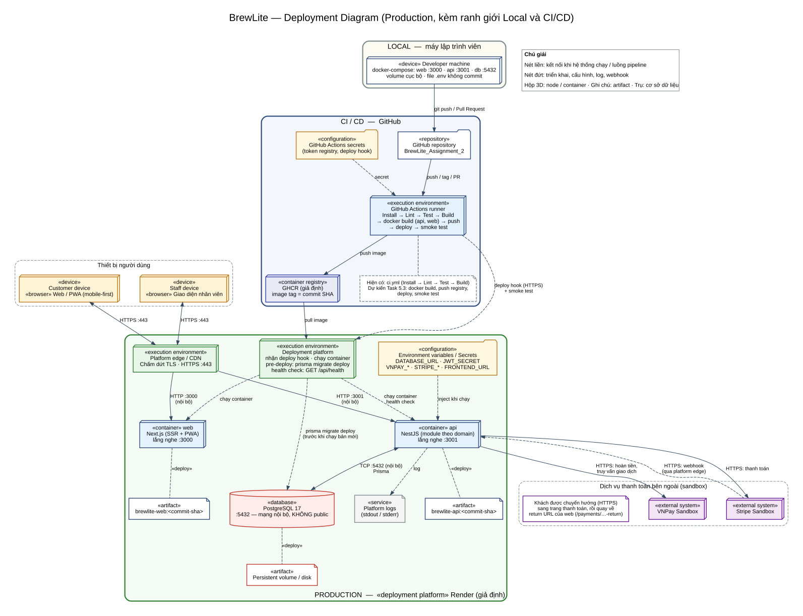

# Hướng dẫn Đóng gói, CI/CD, Triển khai và Vận hành – BrewLite

> **Hạng mục**: Task 5.2 (docker-compose, health), Task 5.3 (CI/CD), Task 5.4 (triển khai và bàn giao)
> **Sơ đồ triển khai**: [`architecture/deployment-diagram.md`](architecture/deployment-diagram.md) · [`architecture/deployment-diagram.svg`](architecture/deployment-diagram.svg)
> **Kiến trúc**: [`architecture/system-architecture.md`](architecture/system-architecture.md)

Tài liệu này mô tả hệ thống **đã được triển khai và kiểm chứng thật ngày 14/11/2026** (xem mục 10). Phần chưa kiểm chứng được ghi rõ ở mục 11.

---

## 1. Tổng quan ba môi trường

| Môi trường | Nơi chạy | Thành phần | Cấu hình |
| --- | --- | --- | --- |
| **Local** | Máy lập trình viên | `docker-compose.yml`: `db` (PostgreSQL 17, :5432), `backend` (NestJS, :3001), `frontend` (Next.js, :3000) | `.env` cá nhân, không commit |
| **CI/CD** | GitHub Actions + GHCR | `ci.yml` (kiểm tra chất lượng), `release.yml` (phát hành), `rollback.yml` (quay về bản cũ) | GitHub Secrets/Variables |
| **Production** | Render | Hai Web Service (`web`, `api`) chạy image từ GHCR, Render PostgreSQL 17 (không public) | Environment Variables trên Render |



Lưu ý kiến trúc: **trình duyệt gọi API trực tiếp** (qua `NEXT_PUBLIC_API_URL`), container `web` không gọi `api` phía server. Vì vậy `api` phải có URL HTTPS công khai và `FRONTEND_URL` của `api` phải đúng domain `web` (CORS).

---

## 2. Biến môi trường và bí mật (chỉ ghi tên, không ghi giá trị)

### 2.1. Dịch vụ `api` (Render Environment Variables / `.env` local)

| Biến | Bắt buộc | Mô tả |
| --- | --- | --- |
| `DATABASE_URL` | Có | Chuỗi kết nối PostgreSQL. Trên Render dùng **Internal Database URL** |
| `JWT_SECRET` | Có | Khóa ký JWT HS256, **tối thiểu 32 ký tự**; API từ chối khởi động nếu thiếu hoặc ngắn |
| `PORT` | Có trên Render | Cổng lắng nghe, đặt `3001` (mặc định trong code cũng là 3001) |
| `FRONTEND_URL` | Có | Origin của `web` cho CORS và URL quay về (ví dụ `https://<web>.onrender.com`) |
| `VNPAY_TMN_CODE`, `VNPAY_HASH_SECRET`, `VNPAY_URL`, `VNPAY_RETURN_URL`, `VNPAY_API_URL` | Khi dùng VNPay | Cấu hình VNPay Sandbox |
| `STRIPE_SECRET_KEY`, `STRIPE_RETURN_URL`, `STRIPE_WEBHOOK_SECRET` | Khi dùng Stripe | Stripe Test mode; webhook là `POST /api/payments/stripe/webhook` |

Cổng thanh toán mô phỏng `WALLET`/`CARD` (`mockOutcome`) không cần biến môi trường riêng.

### 2.2. Dịch vụ `web`

| Biến | Loại | Mô tả |
| --- | --- | --- |
| `NEXT_PUBLIC_API_URL` | **Build-arg** (nhúng lúc build image) | URL API mà trình duyệt gọi, gồm `/api`, ví dụ `https://<api>.onrender.com/api`. Không phải biến chạy: đổi giá trị thì phải build lại image |
| `PORT` | Biến chạy | Đặt `3000` |

### 2.3. GitHub Actions (Settings → Secrets and variables → Actions)

| Tên | Loại | Dùng cho |
| --- | --- | --- |
| `RENDER_API_DEPLOY_HOOK` | Secret | URL Deploy Hook của dịch vụ `api` (chứa khóa) |
| `RENDER_WEB_DEPLOY_HOOK` | Secret | URL Deploy Hook của dịch vụ `web` |
| `RENDER_API_KEY` | Secret (tuỳ chọn) | Cho phép pipeline chờ deploy chuyển sang `live` qua Render API. Không có thì chỉ dựa vào smoke test |
| `PRODUCTION_API_URL` | Variable | URL API gồm `/api`, **dùng cho cả build-arg và smoke test** |
| `PRODUCTION_WEB_URL` | Variable | URL web, dùng cho smoke test |

`GITHUB_TOKEN` có sẵn, dùng để push image lên GHCR (workflow đã khai báo `packages: write`). Hãy tạo **Environment** tên `production` (Settings → Environments) để có thể thêm bước duyệt thủ công nếu cần.

Không có secret nào nằm trong repository. Script triển khai không in URL hook hoặc API key ra log.

---

## 3. Chạy local bằng Docker Compose (Task 5.2)

```powershell
Copy-Item .env.example .env      # rồi đặt JWT_SECRET (>= 32 ký tự), SEED_ADMIN_PASSWORD, SEED_STAFF_PASSWORD
docker compose up --build -d --wait
docker compose ps
```

Với database mới, nạp dữ liệu mẫu (container `backend` đã tự chạy migration khi khởi động):

```powershell
docker compose exec -T backend npm run build:seed
docker compose exec -T backend npm run seed
```

Kiểm tra:

```powershell
curl http://localhost:3001/api/health          # liveness  -> {"status":"ok","service":"brewlite-api"}
curl http://localhost:3001/api/health/ready    # readiness -> {"status":"ok","database":"connected"} hoặc 503 nếu mất DB
```

- Web: `http://localhost:3000`, API: `http://localhost:3001/api`.
- Tài khoản seed: **`admin@gmail.com`** (ADMIN) và **`staff@brewlite.local`** (STAFF), mật khẩu là giá trị bạn đặt ở `SEED_ADMIN_PASSWORD` / `SEED_STAFF_PASSWORD`. **Không có mật khẩu mặc định** và không seed sẵn khách hàng: đăng ký khách tại `/register`.
- Seed đặt lại tồn kho và lượt dùng mã khuyến mãi về giá trị demo; chỉ chạy trên database demo.
- Dừng: `docker compose down` (giữ dữ liệu) hoặc `docker compose down -v` (xóa volume).

---

## 4. Kiểm thử

| Lệnh | Nội dung |
| --- | --- |
| `npm run lint` | ESLint cho `apps/api`, `tests/api`, `apps/web` (`--max-warnings 0`) |
| `npm test` | Unit/integration backend và frontend |
| `npm run test:db` | Toàn bộ suite với PostgreSQL tạm riêng (cần Docker) |
| `npm run test:tools` | Test các script triển khai (`scripts/`), không cần mạng hay thư viện ngoài |
| `npm run docs:check`, `npm run api:check` | Hợp đồng OpenAPI và kiểu dữ liệu sinh tự động |

Idempotency của thanh toán (`POST /api/payments`) được kiểm chứng ở [`requirements/idempotency-acceptance.md`](requirements/idempotency-acceptance.md): replay cùng key và payload trả kết quả cũ với `Idempotency-Replayed: true` **trước** khi kiểm tra đơn đã `PAID`; cùng key khác payload trả `409 IDEMPOTENCY_KEY_REUSED`; đơn `PAYMENT_FAILED` thanh toán lại bằng key mới đi qua `prepareRetry` (giữ lại kho và lượt mã).

---

## 5. Pipeline CI/CD (Task 5.3)

```
Push/Tag → Quality Gate (Lint, Test, Build, E2E) → Build Docker image → Push GHCR → Deploy Render → Smoke test
```

| Workflow | Kích hoạt | Việc làm |
| --- | --- | --- |
| [`ci.yml`](../.github/workflows/ci.yml) | Pull Request, push vào `main`, hoặc được `release.yml` gọi | Cài đặt, `docs:check`, `api:check`, kiểm tra Prisma, `prisma migrate deploy` trên PostgreSQL 17, lint, test, `test:tools`, build, smoke test `/api/health/ready`; **seed + Playwright E2E** khi repo có `tests/e2e/playwright.config.ts` |
| [`release.yml`](../.github/workflows/release.yml) | Push tag `vX.Y.Z` hoặc chạy tay | (1) gọi lại `ci.yml` làm Quality Gate; (2) build và push image `brewlite-api`, `brewlite-web` lên GHCR, tag theo **commit SHA** và theo phiên bản; (3) gọi Deploy Hook Render bằng secret, chờ deploy `live` (nếu có `RENDER_API_KEY`); (4) smoke test HTTPS Web + API health + Catalog |
| [`rollback.yml`](../.github/workflows/rollback.yml) | Chạy tay, nhập `image_tag` | Deploy lại image cũ từ GHCR, rồi smoke test |

Pipeline dừng ở bước đầu tiên thất bại; nếu Quality Gate lỗi thì không có image nào được build, nếu smoke test lỗi thì job báo lỗi kèm hướng dẫn rollback. Bước E2E trình duyệt chỉ chạy khi nhóm đã thêm cấu hình Playwright (Issue #20); chưa có thì bước tự bỏ qua, không làm CI hỏng.

**Migration an toàn**: `prisma migrate deploy` chạy **bên trong môi trường Render**, qua Internal Database URL, không chạy từ runner CI (database production không public). Mặc định container `api` chạy `npm run prisma:deploy && npm start` khi khởi động (`apps/api/Dockerfile`); có thể chuyển sang Pre-Deploy Command của Render nếu gói dịch vụ hỗ trợ. Render chỉ chuyển traffic sang bản mới khi health check `/api/health/ready` đạt.

Script hỗ trợ:

- [`scripts/deploy-render.mjs`](../scripts/deploy-render.mjs): gọi Deploy Hook kèm `imgURL`, thứ tự `api` rồi `web`, chờ `live`.
- [`scripts/smoke-production.mjs`](../scripts/smoke-production.mjs): kiểm tra web (HTTPS), `/health`, `/health/ready` (database `connected`), `/products` (catalog không rỗng); thử lại tối đa 5 phút để chịu được khởi động chậm.
- Test: [`tests/tools/deploy-render.test.mjs`](../tests/tools/deploy-render.test.mjs).

---

## 6. Thiết lập Render và GitHub lần đầu

Thực hiện một lần, theo thứ tự. Các bước dưới đây là các bước nhóm đã làm thật; giao diện Render có thể thay đổi theo thời gian.

1. **Đặt tên dịch vụ và hai Repository variable** (GitHub → Settings → Secrets and variables → Actions → Variables): `PRODUCTION_API_URL` (có `/api` ở cuối) và `PRODUCTION_WEB_URL`. URL suy ra từ tên dịch vụ Render: `https://<tên-dịch-vụ>.onrender.com`. Nhóm dùng `brewlite-api-btram` và `brewlite-web-btram`.
2. **Render PostgreSQL 17**: New → PostgreSQL, tên `brewlite-db`, **Region Singapore**, version 17. Gói Free **hết hạn sau 30 ngày** (database tạo ngày 13/11/2026 hết hạn khoảng 13/12/2026); nâng gói nếu cần dùng lâu hơn. Chép **Internal Database URL**.
3. **Phát hành lần đầu để có image**: GitHub → Actions → Release → Run workflow (nhánh `main`). Hai job `quality` và `images` xanh; job `deploy` lỗi vì chưa có hook (đúng dự kiến).
4. **Đặt hai package GHCR sang Public** (`brewlite-api`, `brewlite-web`), do chủ repo làm (Profile → Packages → Package settings → Change visibility). Hoặc dùng credential GHCR với quyền `read:packages` trong Render.
5. **Dịch vụ `api`**: New → Web Service → *Existing Image* → `ghcr.io/<owner>/brewlite-api:<commit-sha>` (tag SHA lấy ở trang Packages). Region Singapore (cùng region với database). Environment: `DATABASE_URL` (Internal URL), `JWT_SECRET` (tạo bằng `node -e "console.log(require('crypto').randomBytes(48).toString('base64url'))"`), `PORT=3001`, `FRONTEND_URL` (URL của `web`). **Settings → Health Check Path** = `/api/health/ready`.
6. **Dịch vụ `web`**: tương tự với `ghcr.io/<owner>/brewlite-web:<commit-sha>`, `PORT=3000`, Health Check Path `/`. Không đặt `NEXT_PUBLIC_API_URL` ở đây (đã nhúng lúc build).
7. **Deploy Hook**: ở mỗi dịch vụ, Settings → Deploy Hook, chép URL vào GitHub Secrets `RENDER_API_DEPLOY_HOOK`, `RENDER_WEB_DEPLOY_HOOK`. Tạo API Key trong Render Account Settings và lưu `RENDER_API_KEY` để pipeline chờ deploy `live`.
8. **Nạp dữ liệu mẫu một lần** (catalog rỗng thì `/api/products` trả `data` rỗng và smoke test thất bại). Gói Free không có Shell, nên chạy từ máy:
   1. Render → database → **Access Control**: thêm tạm quy tắc cho IP máy bạn (`<ip>/32`; nếu không được thì `0.0.0.0/0`, **chỉ trong thời gian ngắn**).
   2. Chép **External Database URL** và thêm `?sslmode=require` vào cuối. Thiếu SSL thì seed báo `Server has closed the connection` (`P1017`).
   3. Trong **một** cửa sổ PowerShell tại thư mục gốc repo:
      ```powershell
      $env:DATABASE_URL = "<External Database URL>?sslmode=require"
      $env:FRONTEND_URL = "https://<web>.onrender.com"
      $env:SEED_ADMIN_PASSWORD = "<mật khẩu admin>"
      $env:SEED_STAFF_PASSWORD = "<mật khẩu staff>"
      npm --prefix apps/api run prisma:generate
      npm --prefix apps/api run build:seed
      npm --prefix apps/api run seed
      ```
   4. Kiểm tra `https://<api>.onrender.com/api/products` có dữ liệu.
   5. **Dọn ngay**: `Remove-Item Env:DATABASE_URL, Env:SEED_ADMIN_PASSWORD, Env:SEED_STAFF_PASSWORD, Env:FRONTEND_URL`, **xóa quy tắc trong Access Control** và xóa mọi ghi chú có URL kết nối hoặc mật khẩu.
   - Seed đặt lại tồn kho demo; không chạy trên database có dữ liệu thật.
9. **Webhook Stripe** (nếu dùng; chưa kiểm chứng): tạo endpoint `https://<api>.onrender.com/api/payments/stripe/webhook` trong Stripe (Test mode), chép signing secret vào `STRIPE_WEBHOOK_SECRET`. Đặt `VNPAY_RETURN_URL` và `STRIPE_RETURN_URL` về domain `web` thật.

**Đặc điểm của Render cần biết** (theo [tài liệu Render](https://render.com/docs/deploy-an-image)):
- Deploy Hook nhận tham số `imgURL` để chọn tag hoặc digest; **mọi phần khác của URL image phải giống hệt image khai báo ở dịch vụ**, nếu không Render từ chối (HTTP 400). Mã 200 là bắt đầu deploy, 202 là xếp hàng sau một deploy đang chạy (không có deploy id).
- Dịch vụ dùng image **không tự deploy** khi có image mới; phải gọi hook (pipeline đã làm).
- Dịch vụ gói Free **ngủ khi không có truy cập**, request đầu tiên có thể chậm 50 giây trở lên; smoke test chờ tối đa 5 phút.

---

## 7. Phát hành một phiên bản

```bash
git checkout main && git pull
git tag v1.0.0
git push origin v1.0.0
```

Theo dõi tab **Actions**: `quality` → `images` → `deploy`. Khi xong, trang tóm tắt của job `deploy` ghi commit, image đã triển khai và nhắc cách rollback. Tạo GitHub Release từ tag và dán nội dung từ [`release-notes.md`](release-notes.md).

Kiểm tra thủ công (thay URL thật):

```bash
curl -f https://<api>.onrender.com/api/health
curl -f https://<api>.onrender.com/api/health/ready
curl -f https://<api>.onrender.com/api/products
curl -fI https://<web>.onrender.com/
```

---

## 8. Rollback

Rollback đổi lại image đang chạy; **không** hoàn tác migration đã áp dụng.

1. Xác định bản ổn định trước: mở trang tóm tắt của lần `release.yml` thành công liền trước (có commit SHA), hoặc trang Packages của repository trên GitHub.
2. Chạy **Actions → Rollback → Run workflow**, nhập `image_tag` là commit SHA đó. Workflow deploy lại `ghcr.io/<owner>/brewlite-api:<sha>` và `ghcr.io/<owner>/brewlite-web:<sha>`, rồi chạy smoke test.
3. Cách thủ công khi Actions không dùng được: trên Render, vào từng dịch vụ → Manual Deploy → *Deploy an existing image*, nhập tag cũ; hoặc gọi lại Deploy Hook kèm `&imgURL=ghcr.io/<owner>/brewlite-api:<sha>`.
4. Xác minh bằng các lệnh `curl` ở mục 7.

Rollback theo **digest** (bất biến hơn tag): nếu cần, dùng `ghcr.io/<owner>/brewlite-api@sha256:<digest>` (digest lấy ở trang package trên GHCR) thay cho tag.

**An toàn migration**: migration phải tương thích ngược (thêm cột/bảng trước, chỉ xóa cột sau khi bản trước không còn dùng) để image cũ vẫn chạy được trên schema mới. Nếu một migration phá vỡ tương thích, rollback image không đủ: cần khôi phục dữ liệu từ bản sao lưu của Render PostgreSQL.

---

## 9. Giám sát và xử lý sự cố

- **Log**: Render Dashboard → dịch vụ → Logs (stdout/stderr). Log CI không chứa secret.
- **Health**: `/api/health` (tiến trình sống), `/api/health/ready` (database kết nối được; 503 khi mất DB).
- Lỗi thường gặp:

| Hiện tượng | Nguyên nhân thường gặp | Cách xử lý |
| --- | --- | --- |
| `images` lỗi ở bước kiểm tra biến | Chưa đặt `PRODUCTION_API_URL` (HTTPS) | Đặt Repository variable |
| Render không kéo được image | Package GHCR private, chưa có credential | Mục 6 bước 2 |
| `api` không khởi động | `JWT_SECRET` ngắn hơn 32 ký tự, hoặc `DATABASE_URL` sai | Xem log; sửa biến |
| Trình duyệt báo lỗi CORS | `FRONTEND_URL` không khớp domain `web` | Sửa `FRONTEND_URL`, deploy lại `api` |
| Web gọi sai API | Image `web` build với `NEXT_PUBLIC_API_URL` cũ | Sửa `PRODUCTION_API_URL`, phát hành lại |
| Smoke test báo catalog rỗng | Chưa seed database production | Mục 6 bước 8 |
| Seed báo `Server has closed the connection` (`P1017`) | Kết nối từ máy chưa bật SSL, hoặc IP chưa được phép | Thêm `?sslmode=require` vào URL; kiểm tra Access Control |
| Deploy Hook trả HTTP 400 | URL image khác image khai báo ở dịch vụ (khác host hoặc tên) | Dùng đúng `ghcr.io/<owner>/brewlite-<api|web>:<tag>` |
| Smoke test chờ lâu rồi lỗi | Render đang khởi động chậm hoặc deploy lỗi | Xem Logs; cân nhắc rollback |

---

## 10. Bàn giao (Task 5.4)

Triển khai production thực hiện ngày 13–14/11/2026.

| Hạng mục | Giá trị |
| --- | --- |
| URL web (HTTPS) | https://brewlite-web-btram.onrender.com |
| URL API | https://brewlite-api-btram.onrender.com/api |
| Health check | https://brewlite-api-btram.onrender.com/api/health/ready |
| Minh chứng CI trên PR (Task 4.4) | PR [#25](https://github.com/nguyen213123/BrewLite_Assignment_2/pull/25): [CI phát hiện lỗi (`43392242010`)](https://github.com/nguyen213123/BrewLite_Assignment_2/actions/runs/43392242010) → [CI thành công (`43393696567`)](https://github.com/nguyen213123/BrewLite_Assignment_2/actions/runs/43393696567) · Chi tiết: [`qa/ci-evidence.md`](qa/ci-evidence.md) |
| Pipeline phát hiện lỗi và dừng (Release #1, thiếu secret) | https://github.com/nguyen213123/BrewLite_Assignment_2/actions/runs/43389012951 |
| Pipeline thành công (Release #2, commit `294732b`) | https://github.com/nguyen213123/BrewLite_Assignment_2/actions/runs/43543148495 |
| Rollback thành công (Rollback #1) | https://github.com/nguyen213123/BrewLite_Assignment_2/actions/runs/43544766610 |
| Database | Render PostgreSQL 17, Singapore, gói Free, hết hạn khoảng 13/12/2026 |
| Image | `ghcr.io/nguyen213123/brewlite-api` và `brewlite-web`, tag theo commit SHA |
| Video demo, Sprint Review, Retrospective | Xem [`sprints/`](sprints/) |

## 11. Phần chưa kiểm chứng và giới hạn

- Rollback đã chạy thử về **chính** commit SHA đang chạy; chưa thử về một SHA khác, chưa thử rollback theo digest.
- Webhook Stripe và luồng VNPay Sandbox chưa cấu hình trên production; thanh toán mô phỏng `WALLET`/`CARD` chạy không cần cấu hình thêm.
- Migration chạy khi container `api` khởi động; nhóm không dùng Pre-Deploy Command.
- Dịch vụ và database gói Free có giới hạn (ngủ khi nhàn rỗi, database hết hạn sau 30 ngày).
