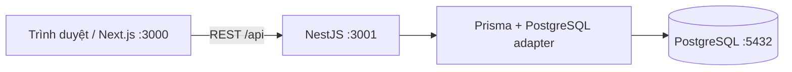

# Sơ đồ dự án

Baseline thiết kế cho issue #1:

- [ERD, ràng buộc/index và chủ bảng](erd.md)
- [Schema Prisma tham chiếu](schema.prisma)
- [Quy tắc nghiệp vụ và bảng chuyển trạng thái](../requirements/business-rules.md)

Schema runtime của khung API đã có 13 bảng nghiệp vụ theo schema tham chiếu và giữ SystemCheck. Áp dụng migration bằng prisma:deploy sau khi trưởng nhóm review/merge PR nền; service nghiệp vụ vẫn phải được từng thành viên thực hiện và kiểm thử.

## Tài liệu hiện tại

- [SRS – Task 1.2](../requirements/Task-1.2-SRS-BrewLite.md)
- [Class diagram – Task 2.3](Task-2.3-Class-Diagram-BrewLite.md)
- [Nguồn Mermaid](class-domain.mmd) và [SVG](class-domain.svg)

Schema hiện tại có 17 model nghiệp vụ và SystemCheck; đoạn baseline 13 bảng phía trên là lịch sử thiết kế issue #1.
