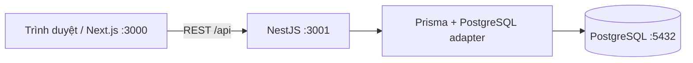

# Danh mục Sơ đồ Mô hình hóa & Kiến trúc – BrewLite

## 1. Sơ đồ Yêu cầu & Use Case (Task 1)

- **System Context Diagram (Task 1.1)**: [`../requirements/context-and-scope.md`](../requirements/context-and-scope.md)
- **Sơ đồ Use Case tổng quát toàn hệ thống (Task 1.2 & 1.3)**: [`../requirements/usecase-brewlite.svg`](../requirements/usecase-brewlite.svg)
- **Sơ đồ Use Case chi tiết Đặt và Thanh toán đơn hàng (Task 1.3)**: [`../requirements/SWE_UC_chitiet.svg`](../requirements/SWE_UC_chitiet.svg) (Đặc tả: [`../requirements/use-cases.md`](../requirements/use-cases.md) / [`../requirements/task1_3.md`](../requirements/task1_3.md))

## 2. Sơ đồ Mô hình hóa Hệ thống UML & ERD (Task 2)

- **Task 2.1 – Activity Diagram (Luồng Xem menu → Giỏ hàng → Đặt đơn → Thanh toán → Theo dõi đơn)**:
  - Mã nguồn PlantUML: [`activity-checkout.puml`](activity-checkout.puml)
  - Ảnh kết xuất SVG: [`activity-checkout.svg`](activity-checkout.svg)
- **Task 2.2 – Sequence Diagram (Luồng Đặt và Thanh toán đơn hàng)**:
  - Mã nguồn PlantUML: [`sequence-checkout.puml`](sequence-checkout.puml)
  - Ảnh kết xuất SVG: [`sequence-checkout.svg`](sequence-checkout.svg)
- **Task 2.3 – Class Diagram & ERD**:
  - Tài liệu đặc tả Class Diagram 3 tầng & ánh xạ Prisma: [`Task-2.3-Class-Diagram-BrewLite.md`](Task-2.3-Class-Diagram-BrewLite.md)
  - Mã nguồn Mermaid Class Diagram: [`class-domain.mmd`](class-domain.mmd)
  - Ảnh kết xuất SVG Class Diagram: [`class-domain.svg`](class-domain.svg)
  - Tài liệu ERD, ràng buộc/index và chủ bảng: [`erd.md`](erd.md)
  - Schema Prisma tham chiếu: [`schema.prisma`](schema.prisma)

## 3. Sơ đồ Kiến trúc & Triển khai (Task 3)

- **Task 3.1 – Kiến trúc hệ thống (C4 Context, Container, Component) & ADRs**:
  - Đặc tả kiến trúc hệ thống: [`../architecture/system-architecture.md`](../architecture/system-architecture.md)
  - Danh mục 7 bản ghi quyết định kiến trúc (ADRs): [`../architecture/adr/README.md`](../architecture/adr/README.md)
- **Task 3.2 – Deployment Diagram (Local, CI/CD, Production – Render & GHCR)**:
  - Tài liệu đặc tả triển khai: [`../architecture/deployment-diagram.md`](../architecture/deployment-diagram.md)
  - Mã nguồn Graphviz DOT: [`../architecture/deployment-diagram.dot`](../architecture/deployment-diagram.dot)
  - Ảnh kết xuất SVG & PNG: [`../architecture/deployment-diagram.svg`](../architecture/deployment-diagram.svg) | [`../architecture/deployment-diagram.png`](../architecture/deployment-diagram.png)
