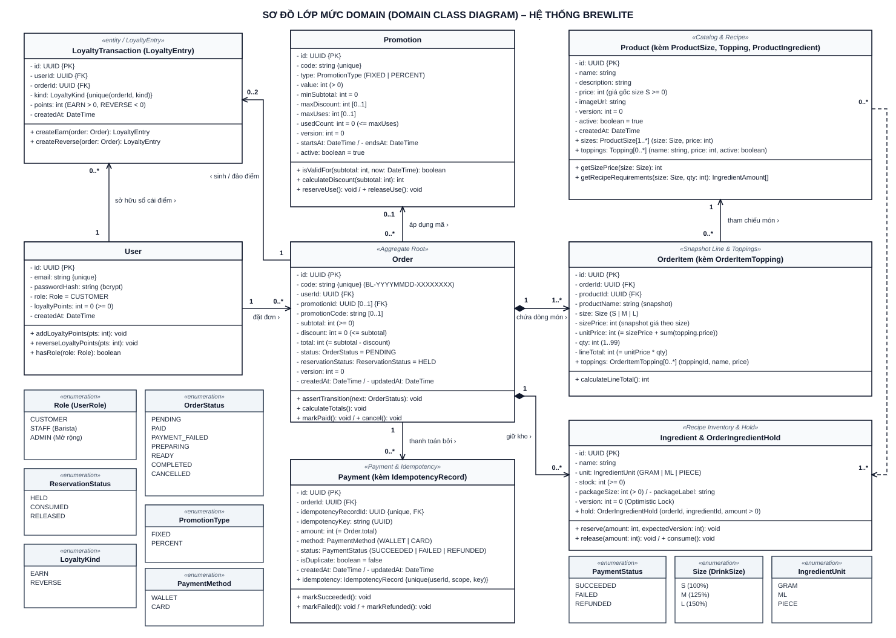

| Thông tin | Chi tiết |
|---|---|
| **Dự án** | BrewLite – Ứng dụng đặt cà phê không dùng tiền mặt |
| **Môn học** | Công nghệ Phần mềm – Trường Đại học Sài Gòn, Khoa CNTT |
| **Hạng mục** | Task 2.3 – Domain Class Diagram (Mô hình lớp mức miền nghiệp vụ) |
| **Phiên bản** | 1.0 |

---

# 1. Sơ đồ lớp mức Domain (Domain Class Diagram)

> *Nguồn sơ đồ:* `class-domain.puml` (`docs/diagrams/class-domain.puml`), bản kết xuất vector `class-domain.svg` và ảnh độ phân giải cao `class-domain.png`.

---

# 2. Mô tả chi tiết các lớp miền nghiệp vụ (Domain Classes)

Sơ đồ mô hình hóa đầy đủ **7 thực thể miền nghiệp vụ bắt buộc của đề bài** (`User`, `Product`, `Order`, `OrderItem`, `Payment`, `Promotion`, `LoyaltyTransaction / LoyaltyEntry`) cùng **lớp tồn kho nguyên liệu theo công thức** (`Ingredient & OrderIngredientHold`) và các thực thể con gắn liền trong codebase mới (`ProductSize`, `Topping`, `OrderItemTopping`, `IdempotencyRecord`, `OrderEvent`). Toàn bộ dữ liệu tiền tệ đều sử dụng kiểu số nguyên (`int` – đơn vị VND) theo đúng ràng buộc SRS và schema Prisma.

| STT | Tên lớp (Domain / Prisma) | Trách nhiệm nghiệp vụ | Thuộc tính chính & Ràng buộc | Phương thức chính | Mã yêu cầu (SRS) |
|---|---|---|---|---|---|
| 1 | **User** | Quản lý tài khoản, danh tính xác thực (JWT), vai trò phân quyền và số dư điểm thưởng tích lũy. | `id: UUID {PK}`, `email: string {unique}`, `passwordHash: string (bcrypt)`, `role: Role = CUSTOMER`, `loyaltyPoints: int = 0 (>= 0)`, `createdAt: DateTime`. | `addLoyaltyPoints(pts: int)`, `reverseLoyaltyPoints(pts: int)`, `hasRole(role: Role)` | FR-08, FR-09, FR-10, FR-23, FR-26, NFR-03, NFR-04 |
| 2 | **Product** *(kèm `ProductSize`, `Topping`, `ProductIngredient`)* | Đại diện cho đồ uống trên thực đơn, giá gốc size S, bảng giá theo size (`ProductSize`), danh sách topping cho phép (`ProductTopping` – `Topping`) và định mức công thức nguyên liệu (`ProductIngredient`). | `id: UUID {PK}`, `name: string`, `description: string`, `price: int (>= 0)`, `imageUrl: string`, `version: int = 0`, `active: boolean = true`, `createdAt: DateTime`; liên kết `sizes: ProductSize[1..*]`, `toppings: Topping[0..*]`. | `getSizePrice(size: Size)`, `getRecipeRequirements(size: Size, qty: int)` | FR-01, FR-02, FR-03, FR-04, FR-12, FR-24 |
| 3 | **Order** *(Aggregate Root, kèm `OrderEvent`)* | Thực thể gốc quản lý đơn hàng, vòng đời trạng thái đơn (`status`), trạng thái giữ kho nguyên liệu (`reservationStatus`), khóa lạc quan (`version`) và các khoản tiền. | `id: UUID {PK}`, `code: string {unique}` (`BL-YYYYMMDD-XXXXXXXX`), `userId: UUID {FK}`, `promotionId: UUID [0..1]`, `promotionCode: string [0..1]`, `subtotal: int`, `discount: int = 0 (<= subtotal)`, `total: int (= subtotal - discount)`, `status: OrderStatus = PENDING`, `reservationStatus: ReservationStatus = HELD`, `version: int = 0`, `createdAt: DateTime`, `updatedAt: DateTime`. | `assertTransition(next: OrderStatus)`, `calculateTotals()`, `markPaid()`, `cancel()` | FR-11, FR-12, FR-16, FR-17, FR-18, FR-19, FR-20, FR-21, FR-25 |
| 4 | **OrderItem** *(kèm `OrderItemTopping`)* | Đại diện cho từng dòng món trong đơn hàng, lưu bản chụp giá (Price Snapshot) theo size và danh sách topping đi kèm của từng ly tại thời điểm đặt. | `id: UUID {PK}`, `orderId: UUID {FK}`, `productId: UUID {FK}`, `productName: string`, `size: Size`, `sizePrice: int`, `unitPrice: int (= sizePrice + sum(topping.price))`, `qty: int (1..99)`, `lineTotal: int (= unitPrice * qty)`, `toppings: OrderItemTopping[0..*] (toppingId, name, price)`. | `calculateLineTotal(): int` | FR-04, FR-11, FR-18 |
| 5 | **Ingredient & OrderIngredientHold** | Quản lý tồn kho ở mức nguyên liệu (`GRAM`, `ML`, `PIECE`), kiểm soát tranh chấp đồng thời bằng khóa lạc quan (`version`) và lưu bản ghi giữ nguyên liệu (`OrderIngredientHold`) cho từng đơn. | `id: UUID {PK}`, `name: string`, `unit: IngredientUnit`, `stock: int (>= 0)`, `packageSize: int (> 0)`, `packageLabel: string`, `version: int = 0`; kèm bản ghi giữ kho `OrderIngredientHold(orderId, ingredientId, amount > 0)`. | `reserve(amount: int, expectedVersion: int)`, `release(amount: int)`, `consume()` | FR-03, FR-12, FR-20, NFR-12 |
| 6 | **Payment** *(kèm `IdempotencyRecord`)* | Quản lý giao dịch thanh toán không tiền mặt, liên kết 1–1 với bản ghi `IdempotencyRecord` để chống tạo đơn/trừ tiền lặp và đánh dấu giao dịch trùng (`isDuplicate`). | `id: UUID {PK}`, `orderId: UUID {FK}`, `idempotencyRecordId: UUID {unique, FK}`, `idempotencyKey: string`, `amount: int (= Order.total)`, `method: PaymentMethod`, `status: PaymentStatus`, `isDuplicate: boolean = false`, `createdAt: DateTime`, `updatedAt: DateTime`. | `markSucceeded()`, `markFailed()`, `markRefunded()` | FR-13, FR-14, FR-15, NFR-12 |
| 7 | **Promotion** | Quản lý mã khuyến mãi, loại giảm giá (`FIXED` / `PERCENT`), điều kiện đơn tối thiểu (`minSubtotal`), trần giảm tối đa (`maxDiscount`), thời hạn hiệu lực và giới hạn lượt dùng (`maxUses`). | `id: UUID {PK}`, `code: string {unique}`, `type: PromotionType`, `value: int (> 0)`, `minSubtotal: int = 0`, `maxDiscount: int [0..1]`, `maxUses: int [0..1]`, `usedCount: int = 0 (<= maxUses)`, `version: int = 0`, `startsAt: DateTime`, `endsAt: DateTime`, `active: boolean = true`. | `isValidFor(subtotal: int, now: DateTime)`, `calculateDiscount(subtotal: int)`, `reserveUse()`, `releaseUse()` | FR-22, FR-24 |
| 8 | **LoyaltyTransaction (`LoyaltyEntry`)** | Sổ cái lưu vết lịch sử cộng điểm thưởng (`EARN`) khi đơn hàng thanh toán thành công và bút toán đảo điểm (`REVERSE`) khi hủy đơn đã thanh toán. | `id: UUID {PK}`, `userId: UUID {FK}`, `orderId: UUID {FK}`, `kind: LoyaltyKind`, `points: int`, `createdAt: DateTime`; ràng buộc duy nhất `@@unique([orderId, kind])`. | `createEarn(order: Order)`, `createReverse(order: Order)` | FR-20, FR-23 |

---

# 3. Đặc tả các kiểu liệt kê trạng thái (Enumerations)

Toàn bộ các trạng thái và phân loại nghiệp vụ trong hệ thống được định nghĩa chặt chẽ bằng kiểu liệt kê (`enum` trong Prisma và `@brewlite/shared-types`), loại trừ hoàn toàn việc dùng chuỗi ký tự tự do:

| Tên Enum | Các giá trị cho phép | Ý nghĩa nghiệp vụ trong hệ thống |
|---|---|---|
| **Role (`UserRole`)** | `CUSTOMER`, `STAFF` *(và mở rộng `ADMIN`)* | Vai trò tài khoản: Khách hàng đặt món (`CUSTOMER`), Nhân viên quầy pha chế (`STAFF` – tương ứng Barista), và Quản lý cửa hàng (`ADMIN` ở mức `Could`). |
| **OrderStatus** | `PENDING`, `PAID`, `PAYMENT_FAILED`, `PREPARING`, `READY`, `COMPLETED`, `CANCELLED` | 7 trạng thái vòng đời của đơn hàng từ lúc khởi tạo, thanh toán, pha chế tại quầy đến khi hoàn tất hoặc hủy. |
| **ReservationStatus** | `HELD`, `CONSUMED`, `RELEASED` | Trạng thái giữ tồn kho nguyên liệu của đơn hàng: đang tạm giữ (`HELD` khi `PENDING`), đã tiêu thụ chính thức (`CONSUMED` khi `PAID` trở đi), hoặc đã giải phóng trả lại kho (`RELEASED` khi `PAYMENT_FAILED` / `CANCELLED`). |
| **PromotionType** | `FIXED`, `PERCENT` *(mở rộng logic `FREE_TOPPING`)* | Hình thức tính chiết khấu khuyến mãi: giảm số tiền cố định (`FIXED`) hoặc giảm theo tỷ lệ phần trăm có trần `maxDiscount` (`PERCENT`). |
| **PaymentMethod** | `WALLET`, `CARD` | Hai phương thức thanh toán không tiền mặt cốt lõi (Ví điện tử và Thẻ ngân hàng, hỗ trợ cổng mô phỏng và mở rộng VNPay/Stripe Sandbox). |
| **PaymentStatus** | `SUCCEEDED`, `FAILED`, `REFUNDED` | Trạng thái của một bản ghi giao dịch thanh toán: thành công (`SUCCEEDED`), thất bại (`FAILED`) hoặc đã hoàn tiền (`REFUNDED`). |
| **LoyaltyKind** | `EARN`, `REVERSE` | Loại bút toán trên sổ cái điểm thưởng (`LoyaltyEntry`): cộng điểm khi thanh toán thành công (`EARN`) hoặc thu hồi điểm khi hủy đơn đã thanh toán (`REVERSE`). |
| **Size (`DrinkSize`)** | `S`, `M`, `L` | Ba kích cỡ ly đồ uống, đồng thời quyết định giá theo size (`ProductSize`) và hệ số định lượng nguyên liệu công thức (`S = 100%`, `M = 125%`, `L = 150%` cho đơn vị `GRAM`/`ML`). |
| **IngredientUnit** | `GRAM`, `ML`, `PIECE` | Đơn vị tính gốc của nguyên liệu trong kho (`Ingredient`): gram (`GRAM`), mililít (`ML`) và cái/viên (`PIECE` – không nhân hệ số size). |

---

# 4. Phân tích kiến trúc: Vai trò của lớp trung gian `OrderItem` và `OrderIngredientHold` (Design Rationale)

## 4.1. Vai trò của lớp `OrderItem` và `OrderItemTopping` (Phân rã N–N & Price Snapshot)

Một quyết định thiết kế cốt lõi trong mô hình miền của **BrewLite** là đơn hàng `Order` không nối trực tiếp sang `Product` mà bắt buộc đi qua lớp trung gian `OrderItem` theo quan hệ hợp thành chặt chẽ (`Order 1 *--> 1..* OrderItem`). Thiết kế này giải quyết 3 bài toán cốt lõi:

1. **Giải quyết quan hệ Nhiều – Nhiều (N – N):**
   - Một đơn hàng (`Order`) có thể chứa nhiều đồ uống khác nhau (`Product`), và một đồ uống (`Product`) xuất hiện trong nhiều đơn hàng của nhiều khách hàng.
   - Lớp `OrderItem` phân rã quan hệ N–N thành hai quan hệ 1–N (`Order 1 *--> 1..* OrderItem` và `Product 1 <-- 0..* OrderItem`), cho phép lưu số lượng ly (`qty`) của từng cấu hình món.
2. **Cơ chế đóng băng giá lúc mua (Price Snapshot):**
   - Trong vận hành thực tế, giá niêm yết của đồ uống (`Product.price`, `ProductSize.price`) hoặc giá topping (`Topping.price`) có thể thay đổi theo thời gian.
   - Khi khách hàng bấm **Đặt đơn**, hệ thống sao chép cứng (snapshot) tên sản phẩm (`productName`), giá theo size (`sizePrice`), tên và giá của từng topping (`OrderItemTopping.name`, `OrderItemTopping.price`), đơn giá tổng hợp (`unitPrice = sizePrice + sum(topping.price)`) và thành tiền dòng (`lineTotal = unitPrice * qty`) vào `OrderItem`. Nhờ vậy, khi xem lại lịch sử đơn hàng hoặc thống kê doanh thu quá khứ, số liệu lịch sử luôn bất biến.
3. **Lưu trữ tùy chọn cá nhân hóa (Size & Topping) của từng ly:**
   - Trong cùng một đơn hàng, khách có thể đặt 2 ly cùng `productId` nhưng khác `size` hoặc khác tập `toppings` (ví dụ: 1 ly Trà sữa size L thêm Trân châu đen, 1 ly Trà sữa size S không topping). Mỗi cấu hình riêng biệt được lưu thành một dòng `OrderItem` độc lập kèm các bản ghi `OrderItemTopping`.

## 4.2. Vai trò của `Ingredient`, `ProductIngredient` và `OrderIngredientHold` (Tồn kho theo công thức)

Thay vì lưu một cột `stock` đơn giản trên bảng `Product` (vốn không phản ánh được việc nhiều món đồ uống và topping dùng chung nguyên liệu như hạt cà phê, sữa tươi, trân châu), kiến trúc mới tách tồn kho sang thực thể **`Ingredient`**:
- **Định mức công thức (`ProductIngredient` & `ToppingIngredient`):** Mỗi món có công thức nguyên liệu chuẩn cho size `S`. Khi khách chọn size `S`/`M`/`L`, lượng nguyên liệu cho 1 ly được tính tự động: nếu đơn vị là `PIECE` thì giữ nguyên `amount`; nếu là `GRAM` hoặc `ML` thì nhân hệ số `S = 100%`, `M = 125%`, `L = 150%` và làm tròn lên `Math.ceil(amount * factor / 100)`.
- **Bản ghi giữ kho (`OrderIngredientHold`):** Khi đơn được tạo ở trạng thái `PENDING`, hệ thống tổng hợp nhu cầu nguyên liệu toàn đơn, trừ `Ingredient.stock` bằng khóa lạc quan (`version`) và ghi lại lượng đã giữ vào `OrderIngredientHold` (`reservationStatus = HELD`). Nếu thanh toán thất bại (`PAYMENT_FAILED`) hoặc đơn bị hủy (`CANCELLED`), hệ thống đọc chính xác `OrderIngredientHold` để cộng trả lại `Ingredient.stock` (`reservationStatus = RELEASED`).

---

# 5. Đặc tả Quan hệ và Bản số (Relationships & Multiplicities)

| Lớp nguồn | Bản số nguồn | Loại quan hệ | Bản số đích | Lớp đích | Quy tắc nghiệp vụ & Ràng buộc toàn vẹn |
|---|---|---|---|---|---|
| **User** | `1` | Association (`đặt đơn`) | `0..*` | **Order** | Một khách hàng có thể đặt `0` hoặc nhiều đơn hàng; mỗi đơn hàng bắt buộc thuộc về đúng `1` tài khoản (`userId`, `onDelete: Restrict`). |
| **Order** | `1` | Composition (`*-->`) | `1..*` | **OrderItem** | Quan hệ hợp thành chặt chẽ: một đơn hàng hợp lệ phải có ít nhất `1` dòng món (`1..*`); `OrderItem` gắn liền với vòng đời của `Order`. |
| **OrderItem** | `0..*` | Association (`tham chiếu món`) | `1` | **Product** | Mỗi dòng `OrderItem` tham chiếu tới đúng `1` `Product` (kèm snapshot tên và giá); một `Product` có thể xuất hiện trong `0..*` dòng đơn hàng. |
| **Product** | `0..*` | Dependency / Recipe (`..>`) | `1..*` | **Ingredient** | Mỗi sản phẩm (và topping) được cấu thành từ `1..*` nguyên liệu qua bảng định mức `ProductIngredient` / `ToppingIngredient`. |
| **Order** | `1` | Composition (`*-->`) | `0..*` | **OrderIngredientHold / Ingredient** | Mỗi đơn hàng lưu các bản ghi giữ chỗ nguyên liệu `OrderIngredientHold` tương ứng với các `Ingredient` đã trừ tạm giữ khi tạo đơn. |
| **Promotion** | `0..1` | Association (`áp dụng mã`) | `0..*` | **Order** | Mỗi đơn hàng áp dụng tối đa `1` mã khuyến mãi (`0..1`); một mã khuyến mãi có thể áp dụng cho `0..*` đơn hàng trong giới hạn `maxUses`. |
| **Order** | `1` | Association (`thanh toán bởi`) | `0..*` | **Payment** | Một đơn hàng có thể có `0..*` lần thử thanh toán (khi thất bại rồi thử lại), nhưng chỉ có tối đa `1` giao dịch đạt trạng thái `SUCCEEDED` (partial unique index). |
| **User** | `1` | Association (`sở hữu sổ cái điểm`) | `0..*` | **LoyaltyTransaction (`LoyaltyEntry`)** | Một người dùng có `0..*` bút toán biến động điểm thưởng theo lịch sử mua và hủy đơn. |
| **Order** | `1` | Association (`sinh / đảo điểm`) | `0..2` | **LoyaltyTransaction (`LoyaltyEntry`)** | Mỗi đơn hàng có tối đa `1` bút toán cộng điểm (`kind = EARN`) khi `PAID` và tối đa `1` bút toán đảo điểm (`kind = REVERSE`) nếu đơn `PAID` bị hủy trước khi pha chế (`@@unique([orderId, kind])`). |

---

# 6. Luồng hoạt động nghiệp vụ trên Sơ đồ lớp (End-to-End Operational Flow)

Bố cục sơ đồ `class-domain.svg` được thiết kế lấy lớp **`Order`** làm trung tâm (**Aggregate Root**). Khi một đơn hàng diễn ra từ lúc đặt đến lúc hoàn tất, dữ liệu và lời gọi phương thức di chuyển tuần tự qua 5 chặng:

## 6.1. Chặng 1: Xác thực người dùng, Kiểm tra Idempotency và Khởi tạo đơn hàng
- **Đường đi trên sơ đồ:** `User` (Hàng giữa – Bên trái) `-->` `Order` (Trung tâm).
- **Quy tắc và Thao tác:**
  - Hệ thống xác thực JWT của `User`, kiểm tra khóa `Idempotency-Key` trong `IdempotencyRecord` (`scope = CREATE_ORDER`).
  - Khởi tạo thực thể `Order` tại trung tâm sơ đồ với `userId = User.id`, sinh mã đơn duy nhất `code` (`BL-YYYYMMDD-XXXXXXXX`), đặt `status = PENDING` và `reservationStatus = HELD`.

## 6.2. Chặng 2: Tạo dòng món (Price Snapshot) và Tạm giữ tồn kho nguyên liệu
- **Đường đi trên sơ đồ:** `Order` (Trung tâm) `*-->` `OrderItem` (Hàng giữa – Bên phải) `-->` `Product` (Góc trên – Bên phải) `..>` `Ingredient & OrderIngredientHold` (Góc dưới – Bên phải).
- **Quy tắc và Thao tác:**
  - Từ `Order`, hệ thống tạo các dòng `OrderItem` và `OrderItemTopping`, đọc giá từ `Product` / `ProductSize` / `Topping` để chụp cứng (`productName`, `sizePrice`, `unitPrice`, `lineTotal = unitPrice * qty`).
  - Đồng thời, `InventoryService` quy đổi định mức công thức (`ProductIngredient` theo hệ số size `S = 100%, M = 125%, L = 150%` và `ToppingIngredient`), sắp xếp theo `ingredientId ASC`, gọi `Ingredient.reserve(amount, expectedVersion)` (trừ `stock`, tăng `version + 1` với điều kiện `stock >= amount`) và lưu bản ghi `OrderIngredientHold`.

## 6.3. Chặng 3: Kiểm tra và Áp dụng mã khuyến mãi (Tùy chọn)
- **Đường đi trên sơ đồ:** `Order` (Trung tâm) `-->` `Promotion` (Hàng trên – Chính giữa).
- **Quy tắc và Thao tác:**
  - Nếu khách có nhập mã giảm giá, hệ thống gọi `Promotion.isValidFor(subtotal, now)` để kiểm tra `active == true`, thời hạn `startsAt..endsAt`, `subtotal >= minSubtotal` và `usedCount < maxUses`.
  - Gọi `Promotion.calculateDiscount(subtotal)` và `Promotion.reserveUse()` (tăng `usedCount + 1` nguyên tử), sau đó `Order.calculateTotals()` tính `total = subtotal - discount`.

## 6.4. Chặng 4: Xử lý thanh toán không tiền mặt và Đồng bộ trạng thái giữ kho
- **Đường đi trên sơ đồ:** `Order` (Trung tâm) `-->` `Payment` (Hàng dưới – Chính giữa) & `Ingredient` (Góc dưới – Bên phải).
- **Quy tắc và Thao tác:**
  - Hệ thống tạo `IdempotencyRecord` (`scope = PAY_ORDER`) và bản ghi `Payment` với `amount = Order.total`.
  - **Nếu thanh toán thành công (`SUCCEEDED`):** Gọi `Payment.markSucceeded()`, `Order.assertTransition(PAID)`, chuyển `Order.reservationStatus` từ `HELD` sang `CONSUMED` (`Ingredient.consume()`).
  - **Nếu thanh toán thất bại (`FAILED`):** Gọi `Payment.markFailed()`, chuyển `Order.status` sang `PAYMENT_FAILED`, đồng thời gọi `Ingredient.release(amount)` và `Promotion.releaseUse()` để hoàn trả nguyên liệu + lượt khuyến mãi (`Order.reservationStatus = RELEASED`). Khi khách bấm thử thanh toán lại (`prepareRetry`), hệ thống giữ lại nguyên liệu (`RELEASED → HELD`) và chuyển đơn về `PENDING`.

## 6.5. Chặng 5: Ghi sổ cái điểm thưởng (`LoyaltyEntry`) và Pha chế hoàn tất
- **Đường đi trên sơ đồ:** `Order` (Trung tâm) `-->` `LoyaltyTransaction (LoyaltyEntry)` (Góc trên – Bên trái) `-->` `User` (Hàng giữa – Bên trái).
- **Quy tắc và Thao tác:**
  - Ngay trong transaction khi `Order` chuyển sang `PAID`, hệ thống gọi `LoyaltyEntry.createEarn(order)` tạo bút toán `kind = EARN` với `points = floor(total / 10000)` và gọi `User.addLoyaltyPoints(points)`.
  - Nếu đơn đang `PAID` (chưa pha chế) mà bị hủy (`PAID → CANCELLED`), hệ thống hoàn trả kho nguyên liệu (`CONSUMED → RELEASED`), đồng thời gọi `LoyaltyEntry.createReverse(order)` tạo bút toán `kind = REVERSE` (`points = -earned`) và trừ lại điểm của `User`.
  - Với đơn hợp lệ, nhân viên pha chế (`User.role == STAFF`) lần lượt cập nhật trạng thái đơn qua `Order.assertTransition()`: `PAID → PREPARING → READY → COMPLETED`.

---

# 7. Kiểm chứng tính nhất quán với SRS, Use-case và Mô hình dữ liệu (Tiêu chí nghiệm thu)

1. **Nhất quán 100% với Tài liệu SRS (Task 1.2) và Đặc tả Use-case 06 (Task 1.3):**
   - Công thức tính giá dòng trong `OrderItem.calculateLineTotal()` (`unitPrice = sizePrice + sum(topping.price)`, `lineTotal = unitPrice * qty`) khớp chính xác với **FR-04 (AC-04.4)** và **FR-11 (AC-11.2)**.
   - Cơ chế tồn kho nguyên liệu theo công thức (`Ingredient`, `ProductIngredient`, `ToppingIngredient`, `OrderIngredientHold`) kèm khóa lạc quan `Ingredient.version` và trạng thái `ReservationStatus` (`HELD`, `CONSUMED`, `RELEASED`) khớp tuyệt đối với **FR-12 (AC-12.1 – AC-12.4)**, **NFR-12** và **UC-06.2**.
   - Cơ chế chống trùng lặp giao dịch thông qua `Payment.idempotencyRecordId {unique}` và `IdempotencyRecord {unique(userId, scope, key)}` khớp với **FR-14 (AC-14.1 – AC-14.4)** và **UC-06.3**.
   - Cơ chế sổ cái điểm thưởng hai chiều `LoyaltyEntry` (`EARN` / `REVERSE`, `@@unique([orderId, kind])`) khớp hoàn toàn với **FR-20 (AC-20.3)**, **FR-23 (AC-23.1 – AC-23.3)** và **UC-08**.
2. **Nhất quán 100% với Mô hình dữ liệu vật lý (`apps/api/prisma/schema.prisma` & `docs/diagrams/erd.md`):**
   - Toàn bộ tên bảng, tên trường khóa chính/khóa ngoại (`UUID`), kiểu tiền tệ (`Int`), các ràng buộc duy nhất (`unique`) và toàn bộ 9 kiểu `enum` trên Sơ đồ lớp mức Domain ánh xạ 1–1 với schema Prisma thực tế đang chạy trong hệ thống.
