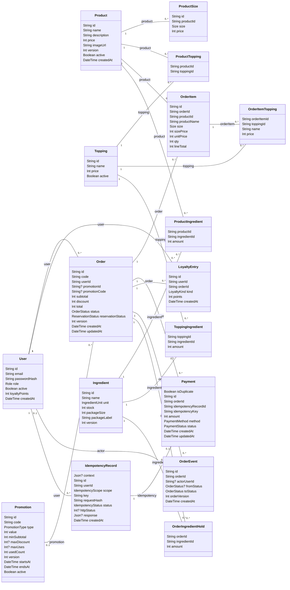

# Task 2.3 – Class diagram BrewLite

Phiên bản 1.1 – đối chiếu SRS Task 1.2, UC-06 và schema hiện tại.

## 1. Sơ đồ lớp

SVG thể hiện thuộc tính, đường nối và bản số ngay trên cùng sơ đồ; Mermaid dưới đây là nguồn đồ thị tương ứng.

Nguồn chỉnh sửa: [class-domain.mmd](./class-domain.mmd). Khối Mermaid dưới đây dùng cùng nội dung nguồn. Không tham chiếu đến PlantUML/PNG chưa có.

Sơ đồ chứa 17 model nghiệp vụ; SystemCheck là bảng kỹ thuật kiểm tra hệ thống. Trường quan hệ hiển thị bằng đường nối, trường scalar giữ đúng tên/type schema. Không gắn các phương thức giả vào Prisma model: xử lý nghiệp vụ nằm trong các service.

## 2. Bản số và ràng buộc

- Mọi khóa ngoại hiện dùng onDelete: Restrict; quan hệ đơn–dòng món không có nghĩa xóa cascade. Schema cho phép 0..* dòng, API tạo đơn bắt buộc ít nhất một dòng hợp lệ.
- ProductSize unique(productId, size); ProductTopping, ProductIngredient, ToppingIngredient, OrderItemTopping và OrderIngredientHold có khóa chính ghép theo hai FK.
- Một Payment bắt buộc có một IdempotencyRecord; một IdempotencyRecord có 0..1 Payment. Unique(userId, scope, key) phân biệt tạo đơn và thanh toán.
- Một Order có nhiều lần thanh toán. Partial unique index chỉ cho một thanh toán chính có status SUCCEEDED/REFUNDED và isDuplicate=false; các biên nhận trùng được lưu riêng, không phải mọi SUCCEEDED đều duy nhất theo orderId.
- LoyaltyEntry unique(orderId, kind): mỗi đơn tối đa một EARN và một REVERSE (0..2 bút toán). OrderEvent unique(orderId, orderVersion), actorUserId và fromStatus có thể null.

## 3. Enum đúng theo schema

| Enum | Giá trị |
|---|---|
| Role | CUSTOMER, STAFF, ADMIN |
| Size | S, M, L |
| OrderStatus | PENDING, PAID, PREPARING, READY, COMPLETED, PAYMENT_FAILED, CANCELLED |
| ReservationStatus | HELD, CONSUMED, RELEASED |
| PromotionType | FIXED, PERCENT |
| PaymentMethod | WALLET, CARD |
| PaymentStatus | SUCCEEDED, FAILED, REFUNDED |
| LoyaltyKind | EARN, REVERSE |
| IdempotencyScope | CREATE_ORDER, PAY_ORDER |
| IdempotencyStatus | PROCESSING, COMPLETED |
| IngredientUnit | GRAM, ML, PIECE |

## 4. Kho, trạng thái và điểm thưởng

UC-06.1 báo giá không giữ kho. UC-06.2 tạo PENDING/HELD, lưu snapshot giá và OrderIngredientHold; Product/Topping không có cột stock. InventoryService tổng hợp ProductIngredient và ToppingIngredient theo ingredientId. Chỉ định mức sản phẩm GRAM/ML nhân S=100%, M=125%, L=150%, làm tròn lên từng ly; PIECE và định mức topping không nhân hệ số size. Cập nhật stock có điều kiện version và stock >= lượng cần, trong transaction cùng đơn và lượt mã.

UC-06.3 thanh toán thành công → PAID/CONSUMED, không trừ kho thêm và không cộng điểm. Thất bại/hủy trước pha chế → RELEASED, hoàn nguyên liệu theo snapshot một lần và hoàn lượt mã. Retry phải giữ lại kho/mã bằng prepareRetry; giá đơn giữ nguyên. PENDING chưa tự hết hạn.

Các cạnh trạng thái: PENDING → PAID/PAYMENT_FAILED/CANCELLED; PAYMENT_FAILED → PENDING/CANCELLED; PAID → PREPARING/CANCELLED; PREPARING → READY; READY → COMPLETED. COMPLETED và CANCELLED kết thúc. Không có cạnh trực tiếp PAYMENT_FAILED → PAID. Khóa dòng Order, version và OrderEvent bảo vệ các chuyển trạng thái.

UC-11 hoàn tất READY → COMPLETED mới gọi LoyaltyService.earn: floor(total/10000), kể cả EARN 0, nếu không có thanh toán chính REFUNDED. API đọc điểm có thể đồng bộ EARN còn thiếu cho đơn đủ điều kiện. Hủy PAID thông thường không có điểm để đảo; reverse chỉ tạo khi tìm thấy EARN trước đó. Hoàn tiền biên nhận trùng không đảo điểm của giao dịch chính.

## 5. Truy vết và kiểm chứng

| Nghiệp vụ | SRS / UC | Code và test liên quan |
|---|---|---|
| Giá theo size, snapshot | FR-04, FR-11 / UC-06.1–06.2 | PricingService; catalog-pricing.e2e-spec.ts, orders-create.integration-spec.ts |
| Giữ/nhả kho nguyên liệu | FR-12 / UC-06.2 | InventoryService, OrderTransactionsService; inventory.integration-spec.ts, two-customers.integration-spec.ts |
| Thanh toán/idempotency | FR-13–15 / UC-06.3 | PaymentsService; payments.e2e-spec.ts, idempotency.e2e-spec.ts |
| Trạng thái pha chế | FR-19–21 / UC-11 | OrdersService; order-state.e2e-spec.ts, order-transitions.integration-spec.ts |
| Điểm khi COMPLETED | FR-23 / UC-08 | LoyaltyService; loyalty.e2e-spec.ts, order-transitions.integration-spec.ts |

Test API ở tests/api/. Danh sách trên là nguồn đối chiếu, không tuyên bố coverage 100% hoặc đã chạy lại toàn bộ test trong lần sửa tài liệu.

[SRS Task 1.2](../requirements/Task-1.2-SRS-BrewLite.md) · [Schema runtime](../../apps/api/prisma/schema.prisma). Task 1.3 riêng chưa có trong repository; tham chiếu UC-06 theo mục 5.3–5.4 của SRS.
