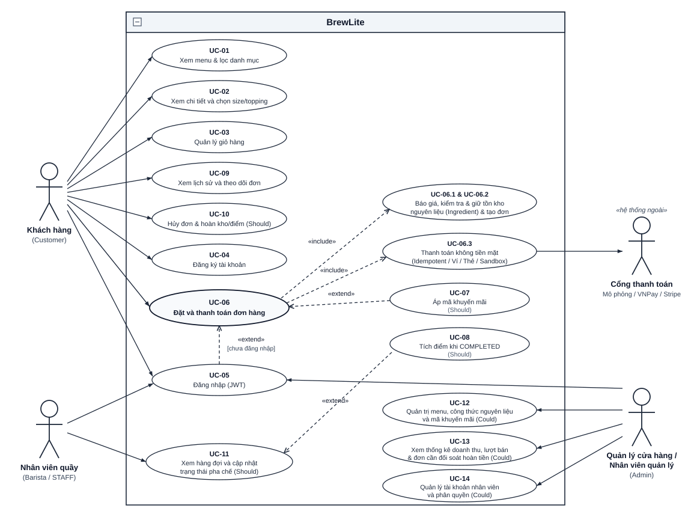

| | |
|---|---|
| **Dự án** | BrewLite – ứng dụng đặt cà phê không dùng tiền mặt |
| **Môn học** | Công nghệ Phần mềm – Trường Đại học Sài Gòn, Khoa CNTT |
| **Phiên bản** | 1.0 |
| **Ngày** | 07/11/2026 |

**Trạng thái** Đặc tả để review ở Task 1. Các AC là mục tiêu nghiệm thu. Tạo phẩm test mới và bằng chứng production sẽ được cập nhật khi các sprint thực hiện.

**Giới thiệu & Quy ước tài liệu:**
- **Luồng nghiệp vụ cốt lõi:** `Xem menu → Chọn tùy chọn → Giỏ hàng → Báo giá & Đặt đơn → Thanh toán → Theo dõi đơn`
- **Công nghệ bắt buộc:** Next.js 16 App Router (mobile-first/PWA), NestJS 11 (REST API tiền tố `/api`), PostgreSQL + Prisma ORM, Docker Compose.
- **Quy ước mã định danh:** `FR-xx` (Yêu cầu chức năng), `NFR-xx` (Yêu cầu phi chức năng), `WONT-xx` (Ngoài phạm vi – mức Won't), `AC-xx.y` (Tiêu chí chấp nhận của `FR-xx`), `AC-NFRxx.y` (Tiêu chí chấp nhận của `NFR-xx`), `UC-xx` (Use-case).
- **Quy ước phương pháp kiểm chứng:** **U** = Unit test, **I** = Integration / E2E API test, **E** = End-to-End UI test, **M** = Kiểm thử thủ công / Kiểm tra cấu hình & CI.

---

# 1. Yêu cầu chức năng (FR-01 đến FR-26)

Các yêu cầu chức năng được tổ chức theo đúng thứ tự các nhóm nghiệp vụ của đề bài: **Menu**, **Chi tiết sản phẩm**, **Giỏ hàng**, **Xác thực**, **Đặt đơn**, **Thanh toán**, **Lịch sử đơn**, **Quản lý trạng thái đơn**, cùng hai nhóm mở rộng **Khuyến mãi & Điểm thưởng** và **Quản trị & Thống kê**.

## 1.1 Menu

### FR-01 – Hiển thị menu đồ uống `Must`

Hệ thống hiển thị danh sách đồ uống khả dụng gồm hình ảnh, tên, danh mục và giá cơ bản (`price`), lấy từ API `GET /api/products`.

- **AC-01.1** Khi mở menu, khách thấy tên, hình ảnh và giá VND của các món đang mở bán. Các tùy chọn topping có ở trang chi tiết.
- **AC-01.2** Given API đang xử lý, When trang tải dữ liệu, Then giao diện hiển thị trạng thái loading (skeleton).
- **AC-01.3** Given không có sản phẩm nào khớp bộ lọc, When khách mở menu, Then giao diện hiển thị trạng thái rỗng kèm thông báo.
- **AC-01.4** Given API trả lỗi hoặc mất kết nối, When khách mở menu, Then giao diện hiển thị thông báo lỗi và nút thử lại.
- **Kiểm chứng:** I (API), U/E (giao diện).

### FR-02 – Lọc và tìm kiếm menu theo danh mục / từ khóa `Could`

Khách lọc danh sách theo nhóm đồ uống (`category`: cà phê, trà, đá xay, ...) hoặc tìm kiếm theo tên/mô tả (`search`) ở client trên danh mục lấy qua API phân trang.

- **AC-02.1** Given menu có nhiều danh mục, When khách chọn một danh mục hoặc nhập từ khóa, Then chỉ các sản phẩm đang khả dụng khớp điều kiện được hiển thị.
- **AC-02.2** Given khách bỏ chọn danh mục hoặc xóa từ khóa, When quay lại "Tất cả", Then toàn bộ sản phẩm khả dụng hiển thị lại.
- **Kiểm chứng:** I, U.

## 1.2 Chi tiết sản phẩm

### FR-03 – Xem chi tiết sản phẩm `Must`

Hệ thống cung cấp `GET /api/products/:id` và màn hình/modal tùy chỉnh sản phẩm gồm hình, tên, mô tả, giá gốc (`price`), các lựa chọn size (`sizes`: S, M, L) và danh sách topping khả dụng (`toppings`).

- **AC-03.1** Khi mở chi tiết món, khách thấy tên, mô tả, hình ảnh, giá và khả dụng theo size, cùng topping được phép chọn.
- **AC-03.2** Given `id` không tồn tại hoặc sản phẩm có `isAvailable = false`, When gọi `GET /api/products/:id`, Then API trả mã `404 PRODUCT_NOT_FOUND` và giao diện hiển thị thông báo không tìm thấy.
- **AC-03.3** Given kho nguyên liệu (`Ingredient.stock`) không đủ đáp ứng định mức công thức của sản phẩm/topping khi đặt đơn, When khách gửi yêu cầu tạo đơn, Then hệ thống báo hết hàng (`409 OUT_OF_STOCK`) kèm thông tin nguyên liệu thiếu và giữ nguyên giỏ để khách điều chỉnh.
- **Kiểm chứng:** I, U.

### FR-04 – Chọn size và topping, tính giá theo tùy chọn `Must`

Khách chọn size (`S`, `M`, `L` – tối đa 1 size) và topping (0 hoặc nhiều topping); giá hiển thị cập nhật tức thời theo lựa chọn.

- **AC-04.1** Khi khách chọn S, M hoặc L, giá dùng `ProductSize.price` tương ứng.
- **AC-04.2** Given khách chọn một hoặc nhiều topping, When thay đổi lựa chọn, Then đơn giá cộng thêm đúng tổng phụ thu của các topping đã chọn (`toppingTotal`).
- **AC-04.3** Khách phải chọn size hợp lệ trước khi thêm món. Giỏ chuẩn hóa tập `toppingIds` để định danh dòng.
- **AC-04.4** Đơn giá bằng giá theo size cộng tổng giá topping. Thành tiền bằng đơn giá nhân số lượng. Server tính lại giá khi báo giá và đặt đơn.
- **Kiểm chứng:** U.

## 1.3 Giỏ hàng

### FR-05 – Thêm sản phẩm vào giỏ `Must`

- **AC-05.1** Given sản phẩm đang mở bán, When khách bấm "Thêm vào giỏ" (số lượng từ 1 đến 99 mỗi dòng, trong giới hạn tồn), Then sản phẩm xuất hiện trong giỏ với đúng `productId`, `size`, `toppingIds`, `quantity` và badge tổng số ly trên thanh điều hướng tăng tương ứng.
- **AC-05.2** Given giỏ đã có cùng sản phẩm với cùng `size` và cùng tập `toppingIds` (sau khi sort), When khách thêm tiếp, Then số lượng của dòng đó được cộng dồn (tối đa 99 ly/dòng) thay vì tạo dòng mới.
- **AC-05.3** Given khách chưa đăng nhập, When thêm vào giỏ, Then thao tác vẫn thành công (giỏ hàng hoạt động ở client không yêu cầu đăng nhập).
- **Kiểm chứng:** U, E.

### FR-06 – Sửa, xóa dòng trong giỏ và tự tính tổng tiền `Must`

- **AC-06.1** Given giỏ có sản phẩm, When khách tăng hoặc giảm số lượng, Then thành tiền dòng và tổng tạm tính (`subtotal`) cập nhật ngay.
- **AC-06.2** Given số lượng của một dòng giảm về 0 hoặc khách bấm xóa dòng / xóa toàn bộ giỏ, When xác nhận, Then dòng tương ứng bị loại khỏi giỏ.
- **AC-06.3** Given giỏ trống, When khách mở giỏ hoặc trang `/checkout`, Then giao diện hiển thị trạng thái giỏ trống và nút quay lại menu; nút đặt đơn/thanh toán không khả dụng.
- **AC-06.4** Tổng tiền của giỏ bằng tổng các thành tiền dòng theo số nguyên VND; đồng thời tại bước checkout, client gọi `POST /api/orders/quote` để đối chiếu báo giá chính thức từ server (`subtotal`, `discount`, `total`).
- **Kiểm chứng:** U, E.

### FR-07 – Lưu trạng thái giỏ trên trình duyệt `Should`

- **AC-07.1** Given giỏ có sản phẩm (và mã khuyến mãi đang chọn nếu có), When khách tải lại trang hoặc đóng và mở lại trình duyệt, Then giỏ được khôi phục từ `localStorage` (`brewlite_cart_v1` / `brewlite_promo_v1`).
- **AC-07.2** Sau khi web xác minh đơn đã thanh toán, hệ thống chỉ loại đúng số lượng của các dòng đã mua. Dòng chưa chọn hoặc vừa thêm vẫn được giữ.
- **Kiểm chứng:** U, E.

## 1.4 Xác thực

### FR-08 – Đăng ký tài khoản `Must`

API `POST /api/auth/register` nhận `email` (chuẩn hóa chữ thường `trim().toLowerCase()`) và `password`.

- **AC-08.1** Email hợp lệ và chưa tồn tại, mật khẩu từ 8 ký tự và tối đa 72 byte UTF-8. Đăng ký trả `201`, JWT và user `CUSTOMER` mà không trả hash mật khẩu.
- **AC-08.2** Đăng ký email đã sử dụng trả `409 EMAIL_ALREADY_EXISTS`.
- **AC-08.3** Email sai định dạng hoặc mật khẩu ngoài giới hạn trả `400 VALIDATION_ERROR`.
- **AC-08.4** Mật khẩu được lưu dưới dạng băm `bcrypt` (cost factor = `12`); không có mật khẩu thô trong cơ sở dữ liệu hay log.
- **AC-08.5** Tài khoản đăng ký công khai luôn có vai trò `CUSTOMER`; tài khoản nhân viên (`STAFF`) hoặc quản trị (`ADMIN`) chỉ được khởi tạo bằng database seed hoặc bởi Admin, không tự đăng ký qua endpoint công khai được.
- **Kiểm chứng:** U, I.

### FR-09 – Đăng nhập và cấp JWT `Must`

API `POST /api/auth/login` xác thực thông tin và trả JWT; API `GET /api/auth/me` trả thông tin phiên hiện tại.

- **AC-09.1** Đăng nhập đúng trả `200`, JWT thời hạn 1 giờ và thông tin user.
- **AC-09.2** Email hoặc mật khẩu sai trả `401 INVALID_CREDENTIALS` với thông báo chung. Tài khoản khóa trả `403 ACCOUNT_LOCKED`.
- **AC-09.3** Given token hết hạn, bị thu hồi hoặc sai chữ ký, When gọi API được bảo vệ (bao gồm `GET /api/auth/me`), Then hệ thống trả mã `401 UNAUTHORIZED`.
- **AC-09.4** Khách có thể chủ động đăng nhập hoặc đăng ký từ thanh điều hướng bất cứ lúc nào, kể cả khi giỏ hàng còn trống; việc đăng nhập không phải là điều kiện để xem menu, xem khuyến mãi công khai (`GET /api/promotions`), xem chi tiết sản phẩm hay thêm vào giỏ.
- **Kiểm chứng:** U, I.

### FR-10 – Bảo vệ chức năng đặt đơn và phân tách dữ liệu người dùng `Must`

- **AC-10.1** Given khách chưa đăng nhập, When gọi `POST /api/orders/quote`, `POST /api/orders`, `POST /api/payments`, `GET /api/orders/me` hoặc `GET /api/loyalty/me` không có JWT hợp lệ, Then API trả mã `401 UNAUTHORIZED`.
- **AC-10.2** Given khách chưa đăng nhập và giỏ có sản phẩm, When chuyển sang bước thanh toán (`/checkout`), Then giao diện chuyển đến `/login?redirect=/checkout` (có liên kết sang `/register?redirect=/checkout`); sau khi đăng nhập hoặc đăng ký thành công, khách được đưa quay lại `/checkout` và giỏ hàng vẫn nguyên vẹn.
- **AC-10.3** Given khách đã đăng nhập, When bấm chuyển sang bước thanh toán, Then giao diện đi thẳng tới màn hình xác nhận đặt đơn & thanh toán, không bị chuyển sang màn hình đăng nhập.
- **AC-10.4** Given khách hàng A, When truy cập hoặc thao tác trên đơn hàng của khách hàng B (`GET /api/orders/:id`, `POST /api/orders/:id/cancel`, `POST /api/payments`), Then API trả mã `403 FORBIDDEN`.
- **Kiểm chứng:** I, E.

## 1.5 Đặt đơn

### FR-11 – Báo giá và tạo đơn hàng ở trạng thái PENDING `Must`

Hệ thống cung cấp `POST /api/orders/quote` để tính thử giá và `POST /api/orders` (kèm header bắt buộc `Idempotency-Key`) để tạo đơn hàng.

- **AC-11.1** Given khách hàng đã đăng nhập, dữ liệu giỏ hợp lệ (1–20 dòng, mỗi dòng `quantity` từ 1 đến 20) và có `Idempotency-Key` hợp lệ, When gửi `POST /api/orders`, Then hệ thống tạo `Order` ở trạng thái `PENDING` (`reservationStatus = HELD`) cùng các `OrderItem`, `OrderItemTopping` và `OrderIngredientHold`, trả mã `201` gồm `id`, `orderNumber` (`BL-YYYYMMDD-XXXXXX`), `subtotal`, `discount`, `total` và danh sách `items`.
- **AC-11.2** Hệ thống tính lại toàn bộ đơn giá, phụ thu size/topping, giảm giá khuyến mãi và tổng tiền ở phía server (`PricingService`); tuyệt đối không tin giá do client gửi lên. Nếu tổng tiền thực tế của đơn (`order.total`) chênh lệch với số tiền đã báo giá trước đó (`quotedTotal` từ `POST /api/orders/quote`), giao diện cảnh báo và yêu cầu khách hàng xác nhận đồng ý mức giá mới hoặc hủy đơn trước khi cho phép thanh toán.
- **AC-11.3** Given giỏ trống, số lượng nhỏ hơn 1, sản phẩm/topping không tồn tại hoặc đang ngừng bán (`isAvailable = false`), hoặc thiếu header `Idempotency-Key`, When tạo đơn, Then hệ thống trả mã `400` (`VALIDATION_ERROR` / `PRODUCT_UNAVAILABLE` / `TOPPING_UNAVAILABLE` / `IDEMPOTENCY_KEY_REQUIRED`) và không tạo đơn.
- **AC-11.4** Việc kiểm tra idempotency (`scope = CREATE_ORDER`), trừ giữ chỗ nguyên liệu, tăng lượt dùng mã khuyến mãi và lưu `Order` diễn ra nguyên tử trong một database transaction; nếu gửi lặp lại cùng `Idempotency-Key` và cùng payload, server trả lại đơn đã tạo kèm header `Idempotency-Replayed: true`.
- **Kiểm chứng:** U, I.

### FR-12 – Kiểm soát tồn kho nguyên liệu theo công thức và xử lý hết hàng `Must`

- **AC-12.1** Given các nguyên liệu (`Ingredient`) trong công thức của sản phẩm (`ProductIngredient`, tính theo hệ số size `S = 100%`, `M = 125%`, `L = 150%` cho đơn vị `GRAM`/`ML` và giữ nguyên cho `PIECE`) và topping (`ToppingIngredient`) còn đủ tồn kho, When đơn được tạo, Then hệ thống tổng hợp nhu cầu theo từng `ingredientId`, trừ `Ingredient.stock`, tăng `Ingredient.version` và lưu bản ghi giữ kho `OrderIngredientHold` (`reservationStatus = HELD`) trong cùng transaction với việc tạo đơn.
- **AC-12.2** Given số lượng nguyên liệu yêu cầu vượt quá `Ingredient.stock`, When tạo đơn, Then hệ thống trả mã `409 OUT_OF_STOCK` (nêu rõ nguyên liệu/sản phẩm thiếu), rollback toàn bộ transaction, không tạo đơn và không làm thay đổi `stock` của bất kỳ nguyên liệu nào.
- **AC-12.3** Given nhiều khách đặt đồng thời các đồ uống dùng chung nguyên liệu chỉ còn *n* đơn vị, When tổng nhu cầu vượt *n*, Then hệ thống sắp xếp nguyên liệu theo `ingredientId ASC` (chống deadlock) và cập nhật có điều kiện theo khóa lạc quan (`WHERE id = ? AND version = ? AND stock >= required`, thử lại tối đa 3 lần trước khi trả `409 STOCK_CONFLICT` hoặc `409 OUT_OF_STOCK`), đảm bảo tổng lượng giữ kho không bao giờ vượt *n* và `Ingredient.stock` không bao giờ âm.
- **AC-12.4** Vòng đời giữ kho (`reservationStatus`) được đồng bộ chặt chẽ với trạng thái đơn:
  - Khi đơn chuyển sang `PAID`: `reservationStatus` chuyển từ `HELD` sang `CONSUMED` (tiêu thụ chính thức).
  - Khi thanh toán thất bại (`PAYMENT_FAILED`) hoặc đơn bị hủy (`CANCELLED` từ `PENDING` hoặc `PAID`): hệ thống giải phóng nguyên liệu (`InventoryService.release`) dựa trên snapshot `OrderIngredientHold`, cộng trả lại `Ingredient.stock`, hoàn lại lượt dùng mã khuyến mãi (`usedCount - 1`) và chuyển `reservationStatus` sang `RELEASED`.
  - Khi khách thử thanh toán lại cho đơn `PAYMENT_FAILED`: hệ thống thực hiện `prepareRetry` để kiểm tra và tạm giữ lại nguyên liệu (`RELEASED → HELD`) cùng mã khuyến mãi trước khi chuyển đơn về `PENDING` và gọi cổng thanh toán.
- **Kiểm chứng:** U, I (test đồng thời tranh chấp tồn kho bắt buộc).

## 1.6 Thanh toán

### FR-13 – Thanh toán không tiền mặt (Mô phỏng Ví/Thẻ & mở rộng VNPay/Stripe Sandbox) `Must`

API `POST /api/payments` nhận `orderId`, `method` (`WALLET` hoặc `CARD`), tùy chọn `mockOutcome` (`SUCCESS` / `FAIL`) và header bắt buộc `Idempotency-Key`. Hệ thống đồng thời cung cấp các endpoint tích hợp môi trường thử nghiệm `/api/payments/vnpay/*` và `/api/payments/stripe/*`.

- **AC-13.1** Đơn `PENDING` hoặc `PAYMENT_FAILED` giữ lại kho thành công có thể được thanh toán. Mock thành công ghi `Payment` là `SUCCEEDED`, chuyển đơn `PAID` và giữ kho `CONSUMED` trong transaction.
- **AC-13.2** Giao diện thanh toán hiển thị rõ bảng tách giá (`subtotal`, `discount`, `total`), các phương thức không tiền mặt (Ví điện tử, Thẻ ngân hàng, cổng VNPay Sandbox / Stripe Test Mode) và không có lựa chọn tiền mặt.
- **AC-13.3** Một lần thanh toán mới cho đơn không thể thanh toán trả `409 ORDER_NOT_PAYABLE`. Replay cùng key vẫn theo FR-14.
- **AC-13.4** Số tiền thanh toán (`amount`) luôn do server lấy trực tiếp từ `order.total` trong cơ sở dữ liệu, không lấy từ client.
- **Kiểm chứng:** U, I, E.

### FR-14 – Thanh toán và tạo đơn idempotent `Must`

- **AC-14.1** Given một yêu cầu thanh toán (`POST /api/payments`) hoặc tạo đơn (`POST /api/orders`) đã xử lý hoàn tất với `Idempotency-Key` *K* của cùng người dùng và cùng `scope`, When client gửi lại cùng *K* và cùng nội dung (`requestHash` SHA-256 trùng khớp), Then hệ thống trả lại đúng mã trạng thái và response body đã lưu kèm header `Idempotency-Replayed: true`, không tạo thêm `Order`/`Payment` và không trừ kho hay trừ tiền lần hai.
- **AC-14.2** Given cùng `Idempotency-Key` *K* nhưng payload khác (`requestHash` khác), When gửi yêu cầu, Then hệ thống từ chối với mã `409 IDEMPOTENCY_KEY_REUSED`.
- **AC-14.3** Given hai yêu cầu cùng `Idempotency-Key` *K* đến đồng thời khi yêu cầu thứ nhất đang xử lý (`status = PROCESSING`), When yêu cầu thứ hai chờ quá thời gian lock hoặc phát hiện đang xử lý, Then chỉ một giao dịch được thực thi và yêu cầu trùng nhận kết quả replay hoặc mã `409 IDEMPOTENCY_IN_PROGRESS` (kèm header `Retry-After: 1`).
- **AC-14.4** Given thiếu header `Idempotency-Key` hoặc giá trị rỗng, When gọi `POST /api/orders` hoặc `POST /api/payments`, Then API trả mã `400 IDEMPOTENCY_KEY_REQUIRED`.
- **Kiểm chứng:** U, I (test gửi lặp và gửi đồng thời cùng key là bắt buộc).

### FR-15 – Xử lý thanh toán thất bại, thử lại và đối soát giao dịch trễ `Must`

- **AC-15.1** Given cổng thanh toán trả kết quả thất bại (`FAIL`), When xử lý, Then hệ thống lưu `Payment` với `status = FAILED`, chuyển đơn sang `PAYMENT_FAILED`, hoàn trả tạm giữ nguyên liệu/khuyến mãi (`reservationStatus = RELEASED`), giữ nguyên giỏ hàng của khách và hiển thị lý do lỗi rõ ràng.
- **AC-15.2** Given đơn đang ở `PAYMENT_FAILED`, When khách chọn thử thanh toán lại (với `Idempotency-Key` mới, có thể đổi phương thức thanh toán), Then hệ thống tự động kiểm tra và giữ lại tồn kho nguyên liệu + khuyến mãi (`prepareRetry`: `PAYMENT_FAILED → PENDING`, `reservationStatus = HELD`) rồi thực hiện thanh toán cho cùng đơn. Nếu khách chọn hủy đơn (FR-20), đơn chuyển sang `CANCELLED`.
- **AC-15.3** Given callback/webhook thanh toán thành công từ cổng ngoài (VNPay/Stripe) đến muộn sau khi đơn đã bị chuyển sang `CANCELLED` (hoặc thanh toán trùng từ nhiều cổng), When hệ thống nhận tín hiệu, Then hệ thống không tự ý mở lại đơn đã hủy và không trừ lại kho, mà ghi nhận `Payment` ở trạng thái cần đối soát (`requiresManualReview = true`, `failureReason = MANUAL_REFUND_REQUIRED` / `DUPLICATE_PAYMENT_MANUAL_REFUND_REQUIRED`) để nhân viên xử lý qua `GET /api/payments/manual-review`.
- **Kiểm chứng:** U, I, E.

### FR-16 – Xác nhận đơn sau thanh toán `Must`

- **AC-16.1** Sau khi API xác nhận thanh toán, `/checkout` hiển thị kết quả và cho mở `/orders/:id`. Chi tiết có mã `code`, trạng thái, các món và tổng tiền.
- **AC-16.2** Màn hình xác nhận/chi tiết đơn có điều hướng rõ ràng để quay lại menu hoặc xem danh sách đơn hàng (`/orders`).
- **Kiểm chứng:** E.

## 1.7 Lịch sử đơn

### FR-17 – Lịch sử đơn của khách hàng `Must`

API `GET /api/orders/me` hỗ trợ phân trang `page` và `limit`.

- **AC-17.1** Lịch sử `/orders` lấy đơn của chính người gọi, mới nhất trước, hiển thị mã `code`, thời gian, tổng tiền và trạng thái. Hàng đợi STAFF dùng `/api/orders/staff` riêng.
- **AC-17.2** Given khách hàng chưa có đơn nào, When mở lịch sử, Then giao diện hiển thị trạng thái rỗng kèm liên kết về menu.
- **AC-17.3** Danh sách của tài khoản `CUSTOMER` tuyệt đối không chứa đơn của người dùng khác.
- **Kiểm chứng:** I, E.

### FR-18 – Xem chi tiết và theo dõi trạng thái đơn `Must`

API `GET /api/orders/:id`.

- **AC-18.1** Given đơn thuộc về khách hàng (hoặc người gọi là `STAFF`), When mở chi tiết đơn (`/orders/:id`), Then hiển thị đầy đủ mã đơn, các dòng sản phẩm (size, topping, số lượng, đơn giá, thành tiền), `subtotal`, `discount`, `total`, lịch sử các lần thanh toán (`payments`) và thanh tiến trình trạng thái hiện tại.
- **AC-18.2** Given khách đang mở màn hình theo dõi đơn hoặc danh sách đơn đang hoạt động, When trạng thái đơn thay đổi ở phía quầy pha chế, Then giao diện tự động làm mới định kỳ (polling mỗi 5 giây) mà không cần tải lại trang.
- **Kiểm chứng:** I, E.

## 1.8 Quản lý trạng thái đơn

### FR-19 – Máy trạng thái đơn hàng `Must`

Các chuyển trạng thái hợp lệ được định nghĩa tập trung tại `ORDER_TRANSITIONS` (`apps/api/src/modules/orders/domain/order-state-machine.ts`):
- `PENDING → PAID | PAYMENT_FAILED | CANCELLED`
- `PAYMENT_FAILED → PENDING | CANCELLED`
- `PAID → PREPARING | CANCELLED`
- `PREPARING → READY`
- `READY → COMPLETED`
- `COMPLETED` và `CANCELLED` là hai trạng thái kết thúc (terminal states).

- **AC-19.1** Given đơn đang ở trạng thái *S*, When yêu cầu chuyển sang *T* không nằm trong tập chuyển hợp lệ, Then hệ thống từ chối với mã `409 INVALID_ORDER_TRANSITION` và trạng thái đơn không đổi.
- **AC-19.2** Given đơn đang ở trạng thái kết thúc (`COMPLETED` hoặc `CANCELLED`), When yêu cầu bất kỳ chuyển trạng thái nào, Then hệ thống từ chối với mã `409 INVALID_ORDER_TRANSITION`.
- **AC-19.3** Chuyển trạng thái đi qua `assertTransition` và `OrderTransactionsService`, có test cạnh hợp lệ và bất hợp lệ.
- **Kiểm chứng:** U.

### FR-20 – Hủy đơn `Should`

API `POST /api/orders/:id/cancel` cho phép chủ đơn hủy đơn khi chưa bước vào pha chế.

- **AC-20.1** Given đơn đang ở `PENDING` hoặc `PAYMENT_FAILED` thuộc về khách hàng, When khách yêu cầu hủy, Then đơn chuyển sang `CANCELLED`; nếu đơn đang giữ nguyên liệu (`reservationStatus = HELD`), hệ thống hoàn trả nguyên liệu vào `Ingredient.stock`, giảm `usedCount` của mã khuyến mãi và chuyển `reservationStatus` sang `RELEASED`.
- **AC-20.2** Given đơn đã chuyển sang `PREPARING`, `READY` hoặc `COMPLETED`, When yêu cầu hủy, Then hệ thống từ chối với mã `409 INVALID_ORDER_TRANSITION` kèm thông báo không thể hủy.
- **AC-20.3** Hủy đơn `PAID` trước pha chế phải xác nhận hoàn tiền theo loại giao dịch, sau đó trả nguyên liệu/lượt mã và chuyển `CANCELLED`. Chỉ đảo điểm khi có bút toán `EARN` trước đó.
- **Kiểm chứng:** U, I.

### FR-21 – Nhân viên quầy (Barista / Staff) cập nhật trạng thái pha chế `Should`

API `PATCH /api/orders/:id/status` được bảo vệ bởi `StaffGuard`.

- **AC-21.1** Given tài khoản có vai trò `STAFF` (Nhân viên quầy / Barista), When gọi `PATCH /api/orders/:id/status` cho đơn `PAID`, Then đơn chỉ được phép chuyển tuần tự qua các bước pha chế `PAID → PREPARING → READY → COMPLETED` (`STAFF_STATUSES`).
- **AC-21.2** Khách gọi API chuyển trạng thái nhận `403 FORBIDDEN`. Với API đối soát, khách chỉ thấy giao dịch của mình.
- **AC-21.3** Giao diện Barista (`/staff`) hiển thị hàng đợi các đơn đang hoạt động (`PAID`, `PREPARING`, `READY`), tự động làm mới định kỳ và có nút chuyển sang bước kế tiếp.
- **Kiểm chứng:** I, E.

## 1.9 Khuyến mãi và điểm thưởng (Mở rộng `Should`)

### FR-22 – Áp mã khuyến mãi `Should`

Hệ thống cung cấp `GET /api/promotions` (danh sách mã đang hiệu lực), `POST /api/promotions/validate` (kiểm tra nhanh mã) và tích hợp tính giảm giá trong `POST /api/orders/quote` & `POST /api/orders`. Hỗ trợ `PERCENT` với trần `maxDiscount` tùy chọn và `FIXED` theo số tiền. Mã demo `FREETOPPING` là mã `FIXED`.

- **AC-22.1** Mã được chuẩn hóa chữ hoa. Với mã active, đúng thời hạn, còn lượt và đạt `minSubtotal`, quote tính giảm giá và tạo đơn giữ lượt một cách nguyên tử.
- **AC-22.2** Mã sai, tắt, ngoài hạn hoặc chưa đủ giá trị đơn trả `422 PROMOTION_INVALID`. Mã hết lượt trả `409 PROMOTION_EXHAUSTED`.
- **AC-22.3** Số tiền giảm không bao giờ vượt quá `subtotal` (`discount = min(rawDiscount, subtotal)`), tổng tiền sau giảm (`total = subtotal - discount`) luôn không âm và được tính toán hoàn toàn ở server.
- **Kiểm chứng:** U, I.

### FR-23 – Cộng và hoàn điểm thưởng (Loyalty Ledger) `Should`

Hệ thống quản lý điểm thưởng qua bảng sổ cái `LoyaltyEntry` (`EARN` / `REVERSE` với ràng buộc duy nhất `@@unique([orderId, kind])`) và cung cấp API `GET /api/loyalty/me`, `GET /api/loyalty/me/entries`.

- **AC-23.1** Khi đơn có khoản thanh toán chính hợp lệ và chuyển `COMPLETED`, cộng `floor(total / 10000)` điểm nếu lớn hơn 0. Cập nhật ledger `EARN` và số dư trong transaction.
- **AC-23.2** Đơn `PENDING`, `PAYMENT_FAILED` hoặc `PAID` chưa hoàn tất chưa được cộng điểm. Khi hủy hợp lệ và đã tồn tại bút toán `EARN`, lưu `REVERSE` để trừ đúng điểm đã cộng.
- **AC-23.3** Nhờ khóa duy nhất `@@unique([orderId, kind])` trên `LoyaltyEntry`, việc cộng điểm (`EARN`) và đảo điểm (`REVERSE`) chỉ xảy ra tối đa một lần cho mỗi đơn, kể cả khi yêu cầu thanh toán hoặc hủy đơn bị gửi lặp.
- **Kiểm chứng:** U, I.

## 1.10 Quản trị và Thống kê (Mở rộng `Could`)

### FR-24 – Quản trị menu, nguyên liệu và mã khuyến mãi `Could`

- **AC-24.1** Given tài khoản Quản lý (`ADMIN`), When thêm, sửa hoặc ẩn một sản phẩm, cập nhật tồn kho nguyên liệu (`Ingredient`) hoặc cấu hình mã khuyến mãi (`Promotion`), Then thay đổi được phản ánh ở menu và bước đặt đơn của khách.
- **AC-24.2** Given tài khoản không phải Quản lý, When gọi API quản trị, Then API trả mã `403 FORBIDDEN`.
- **Kiểm chứng:** I.

### FR-25 – Xem thống kê doanh thu, lượt bán và giao dịch cần đối soát `Could`

API thống kê quản trị (`GET /api/auth/admin/overview`) và API đối soát thanh toán (`GET /api/payments/manual-review`).

- **AC-25.1** Given tài khoản quản lý/vận hành hợp lệ, When truy vấn số liệu thống kê, Then hệ thống trả về tổng doanh thu thực nhận (tổng `total` của các đơn thành công), tổng số đơn hàng thành công, danh sách sản phẩm kèm số lượng đã bán và danh sách các giao dịch thanh toán trễ/trùng cần hoàn tiền thủ công (`requiresManualReview = true`).
- **AC-25.2** Given các đơn hàng ở trạng thái `PENDING`, `PAYMENT_FAILED` hoặc `CANCELLED`, When tính toán doanh thu và lượt bán, Then các đơn này không được cộng vào doanh thu thực nhận.
- **AC-25.3** Given tài khoản khách hàng (`CUSTOMER`), When gọi các endpoint thống kê/đối soát nội bộ, Then API trả mã `403 FORBIDDEN`.
- **Kiểm chứng:** U, I.

### FR-26 – Quản lý tài khoản nhân viên và phân quyền `Could`

API `/api/auth/staff` cho phép ADMIN tạo tài khoản STAFF và thay đổi trạng thái hoạt động.

- **AC-26.1** ADMIN có thể tạo tài khoản `STAFF` bằng email và mật khẩu, xem danh sách và khóa hoặc kích hoạt lại. Mật khẩu được băm bằng bcrypt.
- **AC-26.2** Given tài khoản không có quyền quản trị, When gọi các endpoint quản lý người dùng, Then API trả mã `403 FORBIDDEN`.
- **AC-26.3** Seed demo tạo tài khoản ADMIN và STAFF từ `SEED_ADMIN_PASSWORD` và `SEED_STAFF_PASSWORD`. Khách có thể đăng ký tài khoản mới cho kiểm thử.
- **Kiểm chứng:** U, I.

---

# 2. Yêu cầu phi chức năng (NFR-01 đến NFR-15)

Các yêu cầu phi chức năng được tổ chức theo đúng thứ tự các nhóm trong đề bài: **Hiệu năng**, **Bảo mật**, **Tính khả dụng** và **Khả năng triển khai** (kèm kiểm thử, bảo trì & ghi log).

## 2.1 Hiệu năng

### NFR-01 – Hiệu năng API `Must`

- **AC-NFR01.1** Với dữ liệu mẫu (17 sản phẩm, 5 topping, 20 nguyên liệu), thời gian phản hồi phân vị 95 (p95) của `GET /api/products`, `GET /api/products/:id` và `GET /api/orders/me` nhỏ hơn 500 ms.
- **AC-NFR01.2** `POST /api/orders/quote`, `POST /api/orders` và `POST /api/payments` có p95 nhỏ hơn 1.000 ms (đã gồm xử lý transaction và gọi cổng thanh toán mô phỏng).
- **Kiểm chứng:** M (đo bằng script benchmark/kiểm thử tải, lưu kết quả vào `docs/`).

### NFR-02 – Hiệu năng giao diện `Should`

- **AC-NFR02.1** Trang menu đạt LCP không quá 2,5 giây trên mô phỏng mạng 4G và thiết bị di động trung bình (Lighthouse mobile).
- **Kiểm chứng:** M.

## 2.2 Bảo mật

### NFR-03 – Bảo mật mật khẩu `Must`

- **AC-NFR03.1** Mật khẩu được băm bằng `bcrypt` (hệ số chi phí 12); không lưu và không ghi log mật khẩu thô hay `passwordHash` trong bất kỳ response nào.
- **Kiểm chứng:** U, M.

### NFR-04 – Xác thực và phân quyền `Must`

- **AC-NFR04.1** Mọi API ngoài `GET /api/products`, `GET /api/products/:id`, `GET /api/promotions`, `GET /api/health`, `GET /api/health/ready`, `/api/auth/register`, `/api/auth/login` và các webhook/IPN xác thực chữ ký riêng (`/api/payments/vnpay/ipn`, `/api/payments/stripe/webhook`) đều yêu cầu JWT Bearer hợp lệ.
- **AC-NFR04.2** JWT ký bằng `JWT_SECRET` và có thời hạn 1 giờ theo `AUTH_POLICY`.
- **AC-NFR04.3** Phân quyền theo vai trò (`CUSTOMER`, `STAFF`, `ADMIN`) và kiểm tra quyền sở hữu đơn hàng (`order.userId === currentUser.id`) được thực thi nghiêm ngặt ở tầng server (`JwtAuthGuard`, `StaffGuard`, `AdminGuard`), không phụ thuộc vào việc ẩn nút ở giao diện.
- **Kiểm chứng:** I.

### NFR-05 – Validate dữ liệu đầu vào `Must`

- **AC-NFR05.1** Mọi DTO của API được validate bằng `ValidationPipe` toàn cục (`whitelist: true`, `forbidNonWhitelisted: true`, `transform: true`); dữ liệu không hợp lệ hoặc chứa trường lạ trả mã `400 VALIDATION_ERROR`.
- **AC-NFR05.2** Truy vấn cơ sở dữ liệu dùng Prisma ORM và truy vấn tham số hóa (`$executeRaw` tagged template), tuyệt đối không nối chuỗi SQL từ dữ liệu người dùng.
- **AC-NFR05.3** Giao diện validate các biểu mẫu trước khi gửi và hiển thị thông báo lỗi rõ ràng.
- **Kiểm chứng:** U, I.

### NFR-06 – Quản lý bí mật và cấu hình `Must`

- **AC-NFR06.1** Không có bí mật (`JWT_SECRET`, mật khẩu DB, khóa bí mật thật) bị hardcode trong mã nguồn; repository có `.env.example` ở gốc, `apps/api/.env.example` và `apps/web/.env.example` chỉ chứa giá trị mẫu.
- **AC-NFR06.2** Cấu hình khác nhau giữa local, Docker, CI và production được cung cấp hoàn toàn qua biến môi trường.
- **Kiểm chứng:** M (rà soát repository và log CI).

### NFR-07 – An toàn đường truyền và truy cập dữ liệu `Must`

- **AC-NFR07.1** Frontend và API khi triển khai thực tế truy cập qua HTTPS; header bảo mật HTTP được bật qua middleware `helmet`.
- **AC-NFR07.2** Compose local dùng PostgreSQL qua mạng container và chỉ bind cổng phát triển trên loopback. PostgreSQL production dùng URL nội bộ và tắt truy cập external.
- **AC-NFR07.3** API cấu hình CORS chỉ cho phép origin hợp lệ từ biến môi trường `FRONTEND_URL` và áp dụng giới hạn tần suất request (`express-rate-limit`: mặc định 120 yêu cầu / 60 giây theo địa chỉ IP).
- **Kiểm chứng:** M, I.

## 2.3 Tính khả dụng (Usability, PWA, Tương thích, Sẵn sàng & Toàn vẹn đồng thời)

### NFR-08 – Tính khả dụng của giao diện (Usability) `Must`

- **AC-NFR08.1** Giao diện thiết kế mobile-first, hiển thị và dùng được ở chiều rộng 360 px mà không bị tràn ngang.
- **AC-NFR08.2** Từ menu đến màn hình xác nhận thanh toán, khách hoàn thành đặt đơn trong tối đa 6 màn hình chính (menu, tùy chọn chi tiết, giỏ hàng, đăng nhập nếu cần, thanh toán, xác nhận/chi tiết đơn).
- **AC-NFR08.3** Mọi thao tác có phản hồi trạng thái (loading, thành công, lỗi), thông báo lỗi có mã định danh chuẩn (`ApiErrorEnvelope`) và không lộ stack trace nội bộ.
- **Kiểm chứng:** M, E.

### NFR-09 – PWA `Should`

- **AC-NFR09.1** Ứng dụng có web manifest (`/manifest.webmanifest`) và cấu hình PWA mobile-first.
- **AC-NFR09.2** Khi mất mạng hoặc API lỗi, ứng dụng hiển thị thông báo thân thiện và nút thử lại thay vì làm trắng trang.
- **Kiểm chứng:** M.

### NFR-10 – Tương thích trình duyệt `Must`

- **AC-NFR10.1** Hoạt động đúng trên hai phiên bản mới nhất của Chrome, Edge, Firefox và Safari (di động và máy tính).
- **Kiểm chứng:** M.

### NFR-11 – Tính sẵn sàng và giám sát `Must`

- **AC-NFR11.1** API có endpoint liveness `GET /api/health` và readiness `GET /api/health/ready` (kiểm tra kết nối thực tế tới PostgreSQL bằng `SELECT 1`) trả mã `200` khi hệ thống sẵn sàng.
- **AC-NFR11.2** Mọi lỗi phát sinh trong API đều đi qua `ApiExceptionFilter`, trả lỗi nghiệp vụ theo `statusCode`, `code`, `message`, `details` và không làm sập tiến trình Node.js.
- **Kiểm chứng:** I, M.

### NFR-12 – Toàn vẹn dữ liệu và đồng thời `Must`

- **AC-NFR12.1** Tồn kho nguyên liệu (`Ingredient.stock`) có ràng buộc `CHECK (stock >= 0)` ở mức PostgreSQL và khóa lạc quan `version`, đảm bảo không bao giờ âm và không bán vượt số lượng trong mọi trường hợp đặt đồng thời (xem AC-12.3).
- **AC-NFR12.2** Một yêu cầu tạo đơn hoặc thanh toán gửi lặp lại cùng `Idempotency-Key` không bao giờ tạo hai `Order`/`Payment` hoặc chuyển trạng thái đơn hai lần (xem AC-14.1 đến AC-14.3).
- **AC-NFR12.3** Các thao tác ghi liên quan (tạo đơn, giữ/nhả kho nguyên liệu, tăng/hoàn lượt mã khuyến mãi, cập nhật trạng thái đơn, ghi nhận thanh toán, cộng/đảo điểm thưởng) luôn thực thi trong database transaction (`PrismaService.$transaction`).
- **Kiểm chứng:** U, I.

## 2.4 Khả năng triển khai (kèm Kiểm thử, Bảo trì và Ghi log)

### NFR-13 – Khả năng triển khai `Must`

- **AC-NFR13.1** Một người ngoài nhóm clone repository, làm theo README và chạy được toàn bộ hệ thống (`db`, `backend`, `frontend`) bằng `docker compose up --build -d`.
- **AC-NFR13.2** Migration `npm run prisma:deploy` và các lệnh `build:seed`, `seed` trong `apps/api` tái tạo dữ liệu demo từ database trống.
- **AC-NFR13.3** `ci.yml` kiểm tra hợp đồng, lint, test PostgreSQL, build và E2E trình duyệt. `release.yml` dùng lại CI, đóng gói hai image và chạy deploy/smoke production.
- **AC-NFR13.4** Có quy trình rollback được mô tả trong tài liệu vận hành và migration chạy an toàn thông qua `prisma migrate deploy`.
- **Kiểm chứng:** M, E.

### NFR-14 – Khả năng kiểm thử và bảo trì `Should`

- **AC-NFR14.1** Mã nguồn qua lint không lỗi; có bộ kiểm thử tự động toàn diện cho cả backend (`tests/api/`) và frontend (`apps/web/src/**/*.test.ts`), bao phủ các module `Auth`, `Products`, `Inventory`, `Orders`, `Payments`, `Promotions`, `Loyalty` với độ phủ dòng đạt tối thiểu 70%.
- **AC-NFR14.2** Backend chia module theo domain và dùng kiểu TypeScript được sinh từ `docs/api/openapi.yaml` ở cả API và web.
- **Kiểm chứng:** M (báo cáo test & coverage từ CI).

### NFR-15 – Ghi log và truy vết tương quan `Should`

- **AC-NFR15.1** API gắn `X-Correlation-Id`. Middleware production ghi log với ID, phương thức, mẫu đường dẫn, mã trạng thái và `durationMs`.
- **AC-NFR15.2** Log không chứa mật khẩu, token JWT, khóa bí mật hoặc dữ liệu nhạy cảm của thẻ.
- **Kiểm chứng:** I, M.

---

# 3. Mức ưu tiên theo MoSCoW (Must, Should, Could, Won't)

## 3.1 Ý nghĩa các mức ưu tiên MoSCoW trong dự án BrewLite

| Mức ưu tiên | Ý nghĩa áp dụng trong dự án |
|---|---|
| **Must** | Yêu cầu bắt buộc phải hoàn thành 100% để luồng đặt và thanh toán đơn hàng không tiền mặt chạy end-to-end, đảm bảo an toàn dữ liệu và đạt điều kiện nghiệm thu. |
| **Should** | Yêu cầu quan trọng nâng cao trải nghiệm và vận hành thực tế (lưu giỏ hàng, hủy đơn hoàn kho/điểm, quầy Barista, khuyến mãi, tích điểm, PWA, kiểm thử & ghi log). |
| **Could** | Yêu cầu mở rộng mong muốn khi còn dư thời gian (lọc/tìm kiếm nâng cao, quản trị danh mục/khuyến mãi, thống kê doanh thu, quản lý nhân viên). |
| **Won't** | Yêu cầu nằm ngoài phạm vi phiên bản hiện tại, được ghi nhận rõ ràng để không làm lệch trọng tâm bài tập lớn. |

## 3.2 Bảng phân loại MoSCoW cho Yêu cầu chức năng (FR-01 đến FR-26)

| Mã | Tên yêu cầu chức năng | Nhóm yêu cầu | Ưu tiên MoSCoW |
|---|---|---|---|
| FR-01 | Hiển thị menu đồ uống | Menu | **Must** |
| FR-02 | Lọc và tìm kiếm menu theo danh mục / từ khóa | Menu | **Could** |
| FR-03 | Xem chi tiết sản phẩm | Chi tiết sản phẩm | **Must** |
| FR-04 | Chọn size và topping, tính giá theo tùy chọn | Chi tiết sản phẩm | **Must** |
| FR-05 | Thêm sản phẩm vào giỏ | Giỏ hàng | **Must** |
| FR-06 | Sửa, xóa dòng trong giỏ và tự tính tổng tiền | Giỏ hàng | **Must** |
| FR-07 | Lưu trạng thái giỏ trên trình duyệt | Giỏ hàng | **Should** |
| FR-08 | Đăng ký tài khoản | Xác thực | **Must** |
| FR-09 | Đăng nhập và cấp JWT | Xác thực | **Must** |
| FR-10 | Bảo vệ chức năng đặt đơn và phân tách dữ liệu người dùng | Xác thực | **Must** |
| FR-11 | Báo giá và tạo đơn hàng ở trạng thái PENDING | Đặt đơn | **Must** |
| FR-12 | Kiểm soát tồn kho nguyên liệu theo công thức và xử lý hết hàng | Đặt đơn | **Must** |
| FR-13 | Thanh toán không tiền mặt (Mô phỏng Ví/Thẻ & VNPay/Stripe Sandbox) | Thanh toán | **Must** |
| FR-14 | Thanh toán và tạo đơn idempotent | Thanh toán | **Must** |
| FR-15 | Xử lý thanh toán thất bại, thử lại và đối soát giao dịch trễ | Thanh toán | **Must** |
| FR-16 | Xác nhận đơn sau thanh toán | Thanh toán | **Must** |
| FR-17 | Lịch sử đơn của khách hàng | Lịch sử đơn | **Must** |
| FR-18 | Xem chi tiết và theo dõi trạng thái đơn | Lịch sử đơn | **Must** |
| FR-19 | Máy trạng thái đơn hàng | Quản lý trạng thái đơn | **Must** |
| FR-20 | Hủy đơn (kèm hoàn kho nguyên liệu & đảo điểm thưởng) | Quản lý trạng thái đơn | **Should** |
| FR-21 | Nhân viên quầy (`STAFF`) cập nhật trạng thái pha chế | Quản lý trạng thái đơn | **Should** |
| FR-22 | Áp mã khuyến mãi (`PERCENT`, `FIXED`, `FREE_TOPPING`) | Khuyến mãi và điểm thưởng | **Should** |
| FR-23 | Cộng và hoàn điểm thưởng (`LoyaltyEntry` `EARN`/`REVERSE`) | Khuyến mãi và điểm thưởng | **Should** |
| FR-24 | Quản trị menu, nguyên liệu và mã khuyến mãi | Quản trị và Thống kê | **Could** |
| FR-25 | Xem thống kê doanh thu, lượt bán và giao dịch cần đối soát | Quản trị và Thống kê | **Could** |
| FR-26 | Quản lý tài khoản nhân viên và phân quyền | Quản trị và Thống kê | **Could** |

## 3.3 Bảng phân loại MoSCoW cho Yêu cầu phi chức năng (NFR-01 đến NFR-15)

| Mã | Tên yêu cầu phi chức năng | Nhóm yêu cầu | Ưu tiên MoSCoW |
|---|---|---|---|
| NFR-01 | Hiệu năng API | Hiệu năng | **Must** |
| NFR-02 | Hiệu năng giao diện | Hiệu năng | **Should** |
| NFR-03 | Bảo mật mật khẩu | Bảo mật | **Must** |
| NFR-04 | Xác thực và phân quyền | Bảo mật | **Must** |
| NFR-05 | Validate dữ liệu đầu vào | Bảo mật | **Must** |
| NFR-06 | Quản lý bí mật và cấu hình | Bảo mật | **Must** |
| NFR-07 | An toàn đường truyền và truy cập dữ liệu | Bảo mật | **Must** |
| NFR-08 | Tính khả dụng của giao diện (Usability) | Tính khả dụng | **Must** |
| NFR-09 | PWA | Tính khả dụng | **Should** |
| NFR-10 | Tương thích trình duyệt | Tính khả dụng | **Must** |
| NFR-11 | Tính sẵn sàng và giám sát | Tính khả dụng | **Must** |
| NFR-12 | Toàn vẹn dữ liệu và đồng thời | Tính khả dụng | **Must** |
| NFR-13 | Khả năng triển khai | Khả năng triển khai | **Must** |
| NFR-14 | Khả năng kiểm thử và bảo trì | Khả năng triển khai | **Should** |
| NFR-15 | Ghi log và truy vết tương quan | Khả năng triển khai | **Should** |

## 3.4 Danh mục yêu cầu ngoài phạm vi thực hiện – Won't (WONT-01 đến WONT-09)

| Mã | Nội dung ngoài phạm vi (Won't) | Lý do |
|---|---|---|
| WONT-01 | Thanh toán bằng tiền thật (Production Merchant Gateway) | Chỉ dùng cổng mô phỏng nội bộ và môi trường Sandbox/Test Mode (VNPay Sandbox, Stripe Test Mode) trong phạm vi bài tập lớn. |
| WONT-02 | Tự động hoàn tiền tiền thật qua ngân hàng khi khách hủy đơn | Chỉ hoàn kho nguyên liệu, đảo điểm thưởng và đánh dấu `requiresManualReview` đối với giao dịch trễ. |
| WONT-03 | Thanh toán bằng tiền mặt (COD / trả tiền mặt tại quầy) | Trái với mục tiêu sản phẩm "ứng dụng đặt cà phê không dùng tiền mặt". |
| WONT-04 | Đặt đơn không cần đăng nhập (Guest Checkout) | Cần định danh tài khoản (`userId`) để kiểm soát `IdempotencyRecord`, lưu lịch sử đơn và sổ cái điểm thưởng. |
| WONT-05 | Giao hàng tận nơi, định vị bản đồ và theo dõi shipper | Ngoài phạm vi sản phẩm (khách nhận đồ uống trực tiếp tại quầy). |
| WONT-06 | Đa chi nhánh, điều chuyển kho liên chi nhánh và quản lý lô/hạn sử dụng | Hệ thống quản lý tồn kho theo công thức nguyên liệu (`Ingredient`) cho một cửa hàng duy nhất. |
| WONT-07 | Thông báo đẩy (Web Push / WebSocket) theo thời gian thực | Dùng cơ chế polling định kỳ (5 giây) ở FR-18.2 và FR-21.3 để giữ kiến trúc ổn định. |
| WONT-08 | Đánh giá, bình luận và chấm sao sản phẩm | Không thuộc luồng đặt đơn cốt lõi. |
| WONT-09 | Đa ngôn ngữ, đa tiền tệ | Chỉ hỗ trợ tiếng Việt và đơn vị tiền tệ VND. |

## 3.5 Thống kê tổng hợp theo MoSCoW

| Mức MoSCoW | Yêu cầu chức năng (FR) | Yêu cầu phi chức năng (NFR) | Tổng số |
|---|---|---|---|
| **Must** | 17 (`FR-01, 03, 04, 05, 06, 08, 09, 10, 11, 12, 13, 14, 15, 16, 17, 18, 19`) | 11 (`NFR-01, 03, 04, 05, 06, 07, 08, 10, 11, 12, 13`) | **28** |
| **Should** | 5 (`FR-07, 20, 21, 22, 23`) | 4 (`NFR-02, 09, 14, 15`) | **9** |
| **Could** | 4 (`FR-02, 24, 25, 26`) | 0 | **4** |
| **Won't** | 9 (`WONT-01` đến `WONT-09`) | 0 | **9** |

---

# 4. Kiểm chứng yêu cầu

Các tiêu chí chấp nhận được ghi ngay dưới mỗi FR/NFR. Task 2–3 lập ma trận truy vết từ yêu cầu sang thiết kế. Sprint 1–2 bổ sung đường dẫn code, test và bằng chứng production sau khi chạy.

---

# 5. Sơ đồ Use-case tổng quát của toàn hệ thống

## 5.1 Các tác nhân (Actors)

| Actor | Mô tả trách nhiệm | Vai trò hệ thống |
|---|---|---|
| **Khách hàng (Customer)** | Xem menu, lọc danh mục, xem chi tiết sản phẩm & chọn size/topping, quản lý giỏ hàng, đăng ký, đăng nhập; báo giá, đặt và thanh toán đơn hàng, áp mã khuyến mãi, tích điểm thưởng, xem lịch sử & theo dõi đơn, hủy đơn. | `CUSTOMER` (Tác nhân chính – `Must`) |
| **Nhân viên quầy (Barista / Staff)** | Đăng nhập, xem hàng đợi pha chế, cập nhật trạng thái đơn đã thanh toán (`PAID → PREPARING → READY → COMPLETED`), hủy đơn tác nghiệp và tra cứu danh sách giao dịch cần đối soát hoàn tiền (`manual-review`). | `STAFF` (Tác nhân phụ – `Should`) |
| **Quản lý cửa hàng / Nhân viên quản lý (Admin)** | Đăng nhập, quản trị danh mục sản phẩm, công thức nguyên liệu & mã khuyến mãi (`UC-12`), xem thống kê doanh thu, lượt bán & đơn đối soát (`UC-13`), quản lý tài khoản nhân viên & phân quyền (`UC-14`). | `ADMIN` (Mở rộng – `Could`) |
| **Cổng thanh toán (Mô phỏng / VNPay / Stripe Sandbox)** | Hệ thống ngoài (cổng mô phỏng nội bộ `WALLET`/`CARD` hoặc cổng thử nghiệm **VNPay Sandbox** / **Stripe Test Mode**) xử lý và xác nhận kết quả giao dịch không tiền mặt. | `«hệ thống ngoài»` |

## 5.2 Sơ đồ Use-case tổng quát

> *Nguồn sơ đồ:* `usecase-brewlite.puml` (`docs/diagrams/usecase-overview.puml`), bản kết xuất vector `usecase-brewlite.svg` và ảnh độ phân giải cao `usecase-brewlite.png`.

## 5.3 Danh sách Use-case và truy vết sang Yêu cầu chức năng & API

| Mã Use-case | Tên Use-case | Actor chính | Quan hệ / Ghi chú | Yêu cầu liên quan | API chính trong codebase |
|---|---|---|---|---|---|
| **UC-01** | Xem menu và lọc danh mục | Khách hàng | Độc lập | FR-01, FR-02 | `GET /api/products` |
| **UC-02** | Xem chi tiết và chọn size/topping | Khách hàng | Độc lập | FR-03, FR-04 | `GET /api/products/:id` |
| **UC-03** | Quản lý giỏ hàng | Khách hàng | Độc lập (Client + Quote) | FR-05, FR-06, FR-07 | `localStorage` + `POST /api/orders/quote` |
| **UC-04** | Đăng ký tài khoản | Khách hàng | Độc lập | FR-08 | `POST /api/auth/register` |
| **UC-05** | Đăng nhập (JWT) | Khách hàng, Nhân viên quầy (`STAFF`), Quản lý (`ADMIN`) | Độc lập, đồng thời `«extend»` UC-06 khi khách chưa đăng nhập | FR-09, FR-10 | `POST /api/auth/login`, `GET /api/auth/me` |
| **UC-06** | [Đặt và thanh toán đơn hàng](use-case-checkout.md) *(Use-case trọng tâm – Task 1.3)* | Khách hàng | `«include»` UC-06.1, UC-06.2, UC-06.3; được `«extend»` bởi UC-05, UC-07, UC-08 | FR-10 đến FR-16, FR-19 | `POST /api/orders/quote`, `POST /api/orders`, `POST /api/payments` |
| **UC-07** | Áp mã khuyến mãi | Khách hàng | `«extend»` UC-06 | FR-22 | `GET /api/promotions`, `POST /api/promotions/validate` |
| **UC-08** | Tích / hoàn điểm thưởng | Khách hàng | Ghi điểm khi đơn `COMPLETED`, đảo bút toán cũ khi hủy hợp lệ | FR-23 | `GET /api/loyalty/me`, `GET /api/loyalty/me/entries` |
| **UC-09** | Xem lịch sử và theo dõi đơn | Khách hàng | Độc lập | FR-17, FR-18 | `GET /api/orders/me`, `GET /api/orders/:id` |
| **UC-10** | Hủy đơn & hoàn kho/điểm | Khách hàng, Nhân viên quầy (`STAFF`) | Độc lập | FR-20 | `POST /api/orders/:id/cancel` |
| **UC-11** | Xem hàng đợi và cập nhật trạng thái pha chế | Nhân viên quầy (`STAFF`) | Độc lập | FR-19, FR-21 | `PATCH /api/orders/:id/status` |
| **UC-12** | Quản trị menu, công thức nguyên liệu và mã khuyến mãi | Quản lý cửa hàng (`ADMIN`) | Mở rộng (`Could`) | FR-24 | `/api/auth/admin/products/:id`, `/api/auth/admin/promotions` |
| **UC-13** | Xem thống kê doanh thu, lượt bán & đơn cần đối soát | Quản lý cửa hàng (`ADMIN`) | Mở rộng (`Could`) | FR-25 | `GET /api/payments/manual-review`, `GET /api/admin/stats` |
| **UC-14** | Quản lý tài khoản nhân viên và phân quyền | Quản lý cửa hàng (`ADMIN`) | Mở rộng (`Could`) | FR-26 | `/api/auth/staff`, `prisma/seed.ts` |
