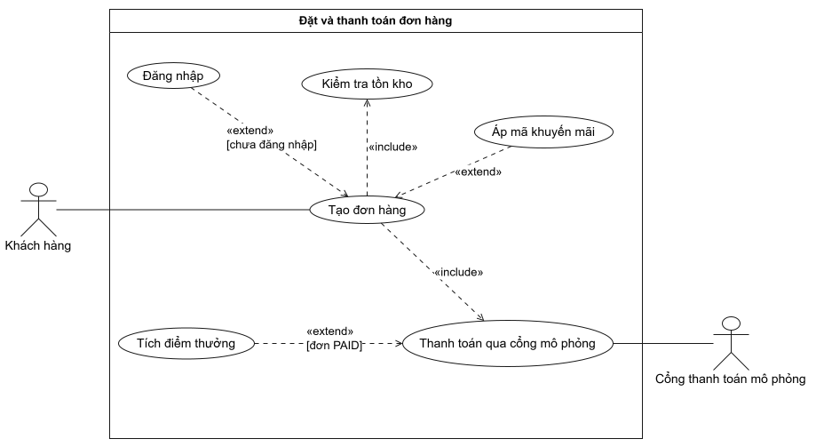

# Đặc tả USECASE 06 - Đặt và thanh toán đơn hàng

## Sơ đồ Use Case

**Sơ đồ Use Case: Đặt và thanh toán đơn hàng**

## Đặc tả các Use Case

### UC - 05 - Đăng nhập

| Nội dung | Mô tả |
| :--- | :--- |
| **Use case ID** | UC - 05 |
| **Use case name** | Đăng nhập |
| **Actor** | Khách hàng (customer) |
| **Tóm tắt** | Người dùng xác thực bằng email và mật khẩu để nhận token JWT, dùng cho các chức năng yêu cầu đăng nhập như đặt đơn. Trong UC-06, use case này chỉ chạy khi khách chưa đăng nhập. |
| **Dòng sự kiện chính** | 1. Hệ thống hiển thị màn hình đăng nhập. 2. Khách hàng nhập email và mật khẩu, bấm "Đăng nhập". 3. Hệ thống validate định dạng dữ liệu đầu vào. 4. Hệ thống tìm tài khoản theo email và so sánh mật khẩu với mật khẩu đã băm (bcrypt). 5. Hệ thống phát JWT cho khách. 6. Client lưu token và chuyển khách về màn hình trước đó (giỏ hàng/thanh toán). Use case kết thúc. |
| **Dòng sự kiện phụ** | **A1. Chưa có tài khoản (tại bước 2):** Khách chọn "Đăng ký" và chuyển sang use case Đăng ký tài khoản (UC-04). Đăng ký xong quay lại bước 2. **E1. Dữ liệu không hợp lệ (tại bước 3):** Email sai định dạng hoặc để trống. Hệ thống báo lỗi tại trường tương ứng, quay lại bước 2. **E2. Sai thông tin đăng nhập (tại bước 4):** Email không tồn tại hoặc mật khẩu sai. Hệ thống báo lỗi chung "Email hoặc mật khẩu không đúng" (không tiết lộ trường nào sai), quay lại bước 2. **E3. Token hết hạn (khi đang đặt đơn):** Hệ thống yêu cầu đăng nhập lại, giữ nguyên giỏ hàng. |
| **Tiền điều kiện** | - Khách đã có tài khoản. - Khách chưa đăng nhập hoặc token đã hết hạn. |
| **Hậu điều kiện** | **Thành công:** Khách có JWT hợp lệ, có thể dùng các chức năng yêu cầu xác thực; giỏ hàng vẫn còn nguyên. **Thất bại:** Không cấp token, khách vẫn ở trạng thái chưa đăng nhập. |

---

### UC - 06.1 - Tạo đơn hàng

| Nội dung | Mô tả |
| :--- | :--- |
| **Use case ID** | UC - 06.1 |
| **Use case name** | Tạo đơn hàng |
| **Actor** | Khách hàng (customer) |
| **Tóm tắt** | Khách hàng chốt giỏ hàng để đặt đơn. Hệ thống kiểm tra danh tính và dữ liệu giỏ hàng, kiểm tra tồn kho, lưu đơn ở trạng thái PENDING, rồi chuyển sang bước thanh toán. Đây là use case xuất phát của khách trong phạm vi UC-06. |
| **Dòng sự kiện chính** | 1. Khách hàng bấm "Thanh toán" tại màn hình giỏ hàng.2. Hệ thống kiểm tra JWT hợp lệ. 3. Hệ thống hiển thị tổng tiền và các phương thức thanh toán (Ví / Thẻ). 4. Khách hàng chọn phương thức và bấm "Xác nhận trả". 5. Hệ thống validate giỏ hàng (sản phẩm tồn tại, size hợp lệ, số lượng > 0) và tính lại tổng tiền ở server. 6. Hệ thống thực hiện use case Kiểm tra tồn kho (UC-06.2) cho các sản phẩm trong giỏ. 7. Hệ thống lưu Order và OrderItem ở trạng thái PENDING, sinh mã đơn. 8. Hệ thống thực hiện use case Thanh toán qua cổng mô phỏng (UC-06.3). 9. Hệ thống hiển thị kết quả: màn hình xác nhận (mã đơn, trạng thái PAID) và xóa giỏ hàng. Use case kết thúc. |
| **Dòng sự kiện phụ** | **A1. Chưa đăng nhập (tại bước 2):** Thực hiện use case Đăng nhập (UC-05), giữ nguyên giỏ hàng. Đăng nhập xong quay lại bước 3. **A2. Có mã khuyến mãi (tại bước 3 đến 4):** Thực hiện use case Áp mã khuyến mãi (UC-07), tổng tiền được cập nhật rồi quay lại bước 4. **E1. Dữ liệu giỏ hàng không hợp lệ (tại bước 5):** Giỏ rỗng, số lượng sai hoặc sản phẩm không tồn tại. Hệ thống báo lỗi, không tạo đơn. Use case kết thúc. **E2. Hết hàng (tại bước 6):** UC-06.2 báo không đủ hàng. Hệ thống không tạo đơn, thông báo sản phẩm hết, giữ nguyên giỏ hàng để khách điều chỉnh. Use case kết thúc. **E3. Thanh toán thất bại (tại bước 8):** Đơn chuyển sang PAYMENT_FAILED, giữ nguyên giỏ hàng, khách có thể thử lại (xem UC-06.3). |
| **Tiền điều kiện** | - Giỏ hàng có ít nhất 1 sản phẩm. - Khách hàng đã đăng nhập. - Hệ thống đang hoạt động. |
| **Hậu điều kiện** | **Thành công:** Đơn được lưu với mã đơn và đã đi qua bước thanh toán (PAID). Giỏ hàng được xóa. **Thất bại:** Nếu dữ liệu sai hoặc hết hàng thì không có đơn nào được tạo, giỏ hàng giữ nguyên. Nếu thanh toán lỗi thì đơn ở PAYMENT_FAILED, giỏ hàng giữ nguyên. |

---

### UC - 06.2 - Kiểm tra tồn kho

| Nội dung | Mô tả |
| :--- | :--- |
| **Use case ID** | UC - 06.2 |
| **Use case name** | Kiểm tra tồn kho |
| **Actor** | Không có actor trực tiếp. Use case được gọi từ UC-06.1 (Tạo đơn hàng), khách hàng chỉ gián tiếp nhận kết quả. |
| **Tóm tắt** | Hệ thống kiểm tra số lượng còn lại của từng sản phẩm trong giỏ và giữ chỗ (trừ tồn kho) trong một transaction, dùng optimistic locking để không bán vượt số lượng khi nhiều khách đặt đồng thời. |
| **Dòng sự kiện chính** | 1. Hệ thống nhận danh sách (sản phẩm, số lượng) từ UC-06.1. 2. Hệ thống mở một transaction. 3. Với mỗi sản phẩm, hệ thống đọc số lượng tồn kho và số phiên bản (version) hiện tại. 4. Hệ thống xác nhận tồn kho đủ so với số lượng đặt. 5. Hệ thống trừ tồn kho bằng cập nhật có điều kiện theo version và tăng version. 6. Hệ thống báo kết quả "đủ hàng" cho UC-06.1. Transaction được commit cùng lúc với việc lưu đơn. Use case kết thúc. |
| **Dòng sự kiện phụ** | **E1. Không đủ hàng (tại bước 4):** Ít nhất một sản phẩm không đủ số lượng. Hệ thống rollback toàn bộ transaction (không trừ kho bất kỳ sản phẩm nào), trả về danh sách sản phẩm thiếu cho UC-06.2. **E2. Xung đột đồng thời (tại bước 5):** Version đã bị thay đổi bởi đơn khác. Hệ thống đọc lại và thử lại, tối đa một số lần giới hạn. Nếu vẫn xung đột thì rollback và báo lỗi cho UC-06.1. **E3. Lỗi cơ sở dữ liệu:** Hệ thống rollback, báo lỗi hệ thống cho UC-06.1. |
| **Tiền điều kiện** | - UC-06.1 đã validate xong danh sách sản phẩm và số lượng. - Cơ sở dữ liệu đang hoạt động. |
| **Hậu điều kiện** | **Thành công:** Tồn kho các sản phẩm đã được trừ trong transaction và chỉ có hiệu lực khi đơn được lưu. **Thất bại:** Transaction bị rollback, tồn kho không thay đổi, không có đơn nào được tạo. |

---

### UC - 07 - Áp mã khuyến mãi

| Nội dung | Mô tả |
| :--- | :--- |
| **Use case ID** | UC - 07 |
| **Use case name** | Áp mã khuyến mãi |
| **Actor** | Khách hàng (customer) |
| **Tóm tắt** | Khách hàng nhập mã giảm giá khi đặt đơn. Hệ thống kiểm tra mã hợp lệ và tính lại tổng tiền sau giảm. Đây là use case tùy chọn, chỉ chạy khi khách có nhập mã. |
| **Dòng sự kiện chính** | 1. Khách hàng nhập mã khuyến mãi tại màn hình thanh toán và bấm "Áp dụng". 2. Hệ thống kiểm tra mã tồn tại và còn hiệu lực (trong thời hạn, còn lượt dùng). 3. Hệ thống kiểm tra đơn đủ điều kiện áp dụng (ví dụ giá trị đơn tối thiểu). 4. Hệ thống tính số tiền giảm và tổng tiền mới. 5. Hệ thống hiển thị tổng tiền sau giảm và gắn mã vào đơn đang đặt. Use case kết thúc. |
| **Dòng sự kiện phụ** | **A1. Khách bỏ mã (sau bước 5):** Khách xóa mã đã áp, hệ thống khôi phục tổng tiền ban đầu. **E1. Mã không tồn tại (tại bước 2):** Hệ thống báo "Mã không hợp lệ", không giảm giá. **E2. Mã hết hạn hoặc hết lượt dùng (tại bước 2):** Hệ thống báo lý do, không giảm giá. **E3. Đơn chưa đủ điều kiện (tại bước 3):** Hệ thống báo điều kiện cần đạt, không giảm giá. *Ở các nhánh E1 đến E3, khách có thể nhập mã khác hoặc tiếp tục đặt đơn không dùng mã.* |
| **Tiền điều kiện** | - Khách đang ở bước đặt đơn (UC-06.1) với giỏ hàng có ít nhất 1 sản phẩm. - Khách có mã khuyến mãi muốn áp dụng. |
| **Hậu điều kiện** | **Thành công:** Tổng tiền được cập nhật sau giảm giá, mã được gắn vào đơn đang đặt. Lượt dùng mã chỉ được tính khi đơn chuyển PAID. **Thất bại:** Tổng tiền không đổi, không có mã nào được gắn vào đơn. |

---

### UC - 06.3 - Thanh toán qua cổng mô phỏng

| Nội dung | Mô tả |
| :--- | :--- |
| **Use case ID** | UC - 06.3 |
| **Use case name** | Thanh toán qua cổng mô phỏng |
| **Actor** | **Chính:** Khách hàng (Customer) (chọn phương thức, thực hiện qua UC-06.1). **Phụ:** Cổng thanh toán mô phỏng (hệ thống ngoài). |
| **Tóm tắt** | Hệ thống gửi yêu cầu thanh toán không tiền mặt (Ví hoặc Thẻ) cho đơn PENDING đến cổng thanh toán mô phỏng. Thành công thì đơn chuyển PAID, thất bại thì chuyển PAYMENT_FAILED. Thanh toán có tính idempotent nhờ Idempotency-Key. |
| **Dòng sự kiện chính** | 1. Hệ thống nhận yêu cầu thanh toán gồm mã đơn, phương thức (Ví/Thẻ) và Idempotency-Key. 2. Hệ thống kiểm tra đơn đang ở trạng thái PENDING và Idempotency-Key chưa được dùng. 3. Hệ thống gửi yêu cầu thanh toán (số tiền, phương thức) đến cổng thanh toán mô phỏng. 4. Cổng thanh toán xử lý và trả kết quả thành công. 5. Hệ thống lưu bản ghi Payment (đơn, key, số tiền, phương thức). 6. Hệ thống chuyển đơn từ PENDING sang PAID. 7. Hệ thống thực hiện use case Tích điểm thưởng (UC-08). 8. Hệ thống trả kết quả thành công cho UC-06.1. Use case kết thúc. |
| **Dòng sự kiện phụ** | **E1. Thanh toán thất bại (tại bước 4):** Số dư không đủ, thẻ bị từ chối hoặc cổng trả lỗi. Hệ thống chuyển đơn sang PAYMENT_FAILED, giữ nguyên giỏ hàng, thông báo lỗi. Khách chọn thử lại (đơn quay về PENDING, bắt đầu lại từ bước 1) hoặc hủy đơn. **E2. Cổng thanh toán quá thời gian chờ (tại bước 3 đến 4):** Xử lý như E1. Khi thử lại dùng cùng Idempotency-Key để tránh trừ tiền hai lần. **E3. Trùng Idempotency-Key (tại bước 2):** Hệ thống không gửi thanh toán lần hai, trả lại kết quả của lần xử lý trước. **E4. Đơn không ở trạng thái PENDING (tại bước 2):** Đơn đã PAID, đã hủy hoặc trạng thái không hợp lệ. Hệ thống từ chối theo state machine và báo lỗi. |
| **Tiền điều kiện** | - Đơn đã được tạo ở trạng thái PENDING và tồn kho đã được giữ. - Khách đã chọn phương thức thanh toán (Ví hoặc Thẻ). - Yêu cầu có Idempotency-Key. - Cổng thanh toán mô phỏng đang hoạt động. |
| **Hậu điều kiện** | **Thành công:** Đơn ở trạng thái PAID, có bản ghi Payment gắn với Idempotency-Key, điểm thưởng đã được xử lý. **Thất bại:** Đơn ở PAYMENT_FAILED (có thể thử lại), giỏ hàng giữ nguyên, không có khoản tiền nào bị trừ. |

---

### UC - 08 - Tích điểm thưởng

| Nội dung | Mô tả |
| :--- | :--- |
| **Use case ID** | UC - 08 |
| **Use case name** | Tích điểm thưởng |
| **Actor** | **Chính:** Khách hàng (Customer) (người nhận điểm, use case do hệ thống kích hoạt sau khi đơn PAID). |
| **Tóm tắt** | Sau khi đơn thanh toán thành công, hệ thống cộng điểm tích lũy cho khách hàng và ghi lại giao dịch điểm. Đây là use case tùy chọn, chỉ chạy khi đơn đã PAID. |
| **Dòng sự kiện chính** | 1. Hệ thống nhận thông báo đơn vừa chuyển sang PAID từ UC-06.3. 2. Hệ thống kiểm tra đơn chưa từng được cộng điểm. 3. Hệ thống tính số điểm theo quy tắc tích điểm. 4. Hệ thống cộng điểm vào tài khoản khách (loyaltyPoints). 5. Hệ thống ghi một giao dịch điểm (LoyaltyTransaction) gắn với đơn. Use case kết thúc. |
| **Dòng sự kiện phụ** | **E1. Đơn chưa PAID:** Hệ thống không thực hiện, không cộng điểm. **E2. Đơn đã được cộng điểm (tại bước 2):** Hệ thống bỏ qua để tránh cộng trùng, ví dụ khi xử lý lại do gửi lại yêu cầu. **E3. Lỗi khi cộng điểm (tại bước 4 đến 5):** Hệ thống ghi log lỗi, không ảnh hưởng trạng thái PAID của đơn, và thử cộng lại sau. |
| **Tiền điều kiện** | - Đơn ở trạng thái PAID. - Đơn chưa có giao dịch điểm. - Đơn thuộc về một tài khoản khách hàng. |
| **Hậu điều kiện** | **Thành công:** Điểm của khách tăng đúng số điểm tính được, có đúng một LoyaltyTransaction cho đơn. **Thất bại:** Điểm không đổi, đơn vẫn PAID và có thể xử lý cộng điểm lại sau. |