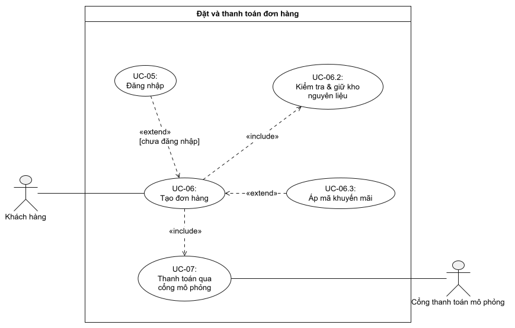

# Đặc tả USECASE 06 - Đặt và thanh toán đơn hàng

## Quan hệ giữa các use case (theo sơ đồ)

| Use case | Tên use case | Actor | Quan hệ |
| --- | --- | --- | --- |
| UC-06 | Tạo đơn hàng | Khách hàng | Use case gốc. `«include»` UC-06.2 và UC-07; được `«extend»` bởi UC-05 (khi chưa đăng nhập) và UC-06.3 (khi có mã khuyến mãi) |
| UC-05 | Đăng nhập | Khách hàng | `«extend»` UC-06, điều kiện: chưa đăng nhập |
| UC-06.2 | Kiểm tra & giữ kho nguyên liệu | Không có actor trực tiếp | `«include»` bởi UC-06 |
| UC-06.3 | Áp mã khuyến mãi | Khách hàng | `«extend»` UC-06 |
| UC-07 | Thanh toán qua cổng mô phỏng | Cổng thanh toán mô phỏng | `«include»` bởi UC-06 |

> Ngoài phạm vi sơ đồ: tích điểm thưởng (FR-23) không nằm trong luồng đặt và thanh toán; chỉ chạy khi nhân viên chuyển đơn sang COMPLETED (UC-11).

## Truy vết yêu cầu (UC → FR trong SRS Task 1.2)

| Use case | Tên use case | Mã yêu cầu (FR/NFR) | Ghi chú |
| --- | --- | --- | --- |
| UC-06 (gồm các use case con) | Đặt và thanh toán đơn hàng | FR-10 đến FR-16, FR-19, FR-22 | Toàn bộ phạm vi của sơ đồ |
| UC-05 | Đăng nhập | FR-09, FR-10 | FR-10 (AC-10.2): quay lại `/checkout`, giỏ hàng giữ nguyên |
| UC-06 | Tạo đơn hàng | FR-10, FR-11, FR-14, FR-16, FR-19 | FR-11: tạo đơn `PENDING`, tính lại tổng tiền ở server; FR-14 (AC-14.1): `Idempotency-Key` khi tạo đơn; FR-16: xác nhận đơn |
| UC-06.2 | Kiểm tra & giữ kho nguyên liệu | FR-12, FR-03 | FR-12 (AC-12.1 đến AC-12.3): quy đổi công thức, `Ingredient`, `OrderIngredientHold` (HELD), khóa lạc quan; FR-03 (AC-03.3): `409 OUT_OF_STOCK`; NFR-12 |
| UC-06.3 | Áp mã khuyến mãi | FR-22 | AC-22.1 đến AC-22.3 |
| UC-07 | Thanh toán qua cổng mô phỏng | FR-13, FR-14, FR-15, FR-19, FR-12 | FR-13: thanh toán không tiền mặt; FR-14: idempotent; FR-15: thất bại và thử lại; FR-12 (AC-12.4): nhả/giữ lại nguyên liệu; NFR-12 |

## UC-05: Đăng nhập

| Mục | Nội dung |
| --- | --- |
| Yêu cầu liên quan (FR/NFR) | FR-09 (AC-09.1 đến AC-09.3), FR-10 (AC-10.2) |
| Actor | Khách hàng (customer) |
| Trigger | Khách bấm "Đăng nhập", hoặc bị chuyển sang đăng nhập từ UC-06 (A1, E4) khi chưa có JWT hợp lệ. |
| Tóm tắt | Người dùng xác thực bằng email và mật khẩu để nhận token JWT, dùng cho các chức năng yêu cầu đăng nhập như đặt đơn. Use case này `«extend»` UC-06 và chỉ chạy khi khách chưa đăng nhập. |
| Dòng sự kiện chính | 1. Hệ thống hiển thị màn hình đăng nhập. 2. Khách hàng nhập email và mật khẩu, bấm “Đăng nhập”. 3. Hệ thống validate định dạng dữ liệu đầu vào. 4. Hệ thống tìm tài khoản theo email và so sánh mật khẩu với mật khẩu đã băm (bcrypt). 5. Hệ thống phát JWT cho khách. 6. Client lưu token và chuyển khách về màn hình trước đó (giỏ hàng/thanh toán). Use case kết thúc. |
| Dòng sự kiện phụ | **A1. Chưa có tài khoản (tại bước 2):** khách chọn “Đăng ký” và chuyển sang use case Đăng ký tài khoản (UC-04). Đăng ký xong quay lại bước 2. **E1. Dữ liệu không hợp lệ (tại bước 3):** email sai định dạng hoặc để trống. Hệ thống báo lỗi tại trường tương ứng, quay lại bước 2. **E2. Sai thông tin đăng nhập (tại bước 4):** email không tồn tại hoặc mật khẩu sai. Hệ thống báo lỗi chung “Email hoặc mật khẩu không đúng” (không tiết lộ trường nào sai), quay lại bước 2. **E3. Token hết hạn (khi đang đặt đơn):** hệ thống yêu cầu đăng nhập lại, giữ nguyên giỏ hàng. |
| Tiền điều kiện | • Khách đã có tài khoản. • Khách chưa đăng nhập hoặc token đã hết hạn. |
| Hậu điều kiện | **Thành công:** khách có JWT hợp lệ, có thể dùng các chức năng yêu cầu xác thực; giỏ hàng vẫn còn nguyên. **Thất bại:** không cấp token, khách vẫn ở trạng thái chưa đăng nhập. |

## UC-06: Tạo đơn hàng

| Mục | Nội dung |
| --- | --- |
| Yêu cầu liên quan (FR/NFR) | FR-10 (AC-10.1 đến AC-10.3), FR-11 (AC-11.1 đến AC-11.4), FR-14 (AC-14.1), FR-16 (AC-16.1), FR-19 (AC-19.1) |
| Actor | Khách hàng (customer) |
| Trigger | Khách hàng bấm "Thanh toán" tại màn hình giỏ hàng. |
| Tóm tắt | Khách hàng chốt giỏ hàng để đặt đơn. Hệ thống kiểm tra danh tính và dữ liệu giỏ hàng, thực hiện UC-06.2 để kiểm tra và giữ kho nguyên liệu, lưu đơn ở trạng thái PENDING, rồi thực hiện UC-07 để thanh toán. Đây là use case gốc của phạm vi đặt và thanh toán đơn hàng: `«include»` UC-06.2 và UC-07; được `«extend»` bởi UC-05 (chưa đăng nhập) và UC-06.3 (có mã khuyến mãi). |
| Dòng sự kiện chính | 1. Khách hàng bấm “Thanh toán” tại màn hình giỏ hàng. 2. Hệ thống kiểm tra JWT hợp lệ. 3. Hệ thống hiển thị tổng tiền và các phương thức thanh toán (Ví / Thẻ). 4. Khách hàng chọn phương thức và bấm “Xác nhận trả”; client sinh Idempotency-Key tạo đơn. 5. Hệ thống kiểm tra lại JWT, validate giỏ hàng (sản phẩm tồn tại, size hợp lệ, số lượng > 0) và tính lại tổng tiền ở server. 6. Hệ thống thực hiện use case Kiểm tra & giữ kho nguyên liệu (UC-06.2) cho các dòng trong giỏ. 7. Hệ thống lưu Order, OrderItem (PENDING) và OrderIngredientHold (HELD), tăng lượt dùng mã khuyến mãi (nếu có), sinh mã đơn, rồi commit transaction. 8. Hệ thống thực hiện use case Thanh toán qua cổng mô phỏng (UC-07). 9. Hệ thống hiển thị kết quả: màn hình xác nhận (mã đơn, trạng thái PAID) và xóa giỏ hàng. Use case kết thúc. |
| Dòng sự kiện phụ | **A1. Chưa đăng nhập (tại bước 2):** thực hiện use case Đăng nhập (UC-05, `«extend»`), giữ nguyên giỏ hàng. Đăng nhập xong quay lại bước 3. **A2. Có mã khuyến mãi (tại bước 3 đến 4):** thực hiện use case Áp mã khuyến mãi (UC-06.3, `«extend»`), tổng tiền được cập nhật rồi quay lại bước 4. **E1. Dữ liệu giỏ hàng không hợp lệ (tại bước 5):** giỏ rỗng, số lượng sai hoặc sản phẩm không tồn tại. Hệ thống báo lỗi 400, không tạo đơn. Use case kết thúc. **E2. Hết nguyên liệu (tại bước 6):** UC-06.2 báo không đủ nguyên liệu (409 OUT_OF_STOCK). Hệ thống không tạo đơn, thông báo sản phẩm hết, giữ nguyên giỏ hàng để khách điều chỉnh. Use case kết thúc. **E3. Xung đột đồng thời hoặc lỗi hệ thống (tại bước 6):** UC-06.2 đã rollback và báo lỗi. Hệ thống không tạo đơn, báo lỗi, giữ nguyên giỏ hàng. Use case kết thúc. **E4. JWT hết hạn khi gửi yêu cầu đặt đơn (tại bước 5):** hệ thống trả 401 và yêu cầu đăng nhập lại (UC-05), giữ nguyên giỏ hàng. **E5. Thanh toán thất bại (tại bước 8):** đơn chuyển sang PAYMENT_FAILED, giữ nguyên giỏ hàng, khách có thể thử lại bằng key mới (xem UC-07, A1) hoặc hủy đơn. |
| Tiền điều kiện | • Giỏ hàng có ít nhất 1 sản phẩm. • Khách hàng đã đăng nhập (nếu chưa, UC-05 được gọi ở A1). • Hệ thống đang hoạt động. |
| Hậu điều kiện | **Thành công:** đơn được lưu với mã đơn và đã đi qua bước thanh toán (PAID). Giỏ hàng được xóa. **Thất bại:** nếu dữ liệu sai, hết nguyên liệu hoặc lỗi hệ thống thì không có đơn nào được tạo, giỏ hàng giữ nguyên. Nếu thanh toán lỗi thì đơn ở PAYMENT_FAILED, giỏ hàng giữ nguyên. |

## UC-06.2: Kiểm tra & giữ kho nguyên liệu

| Mục | Nội dung |
| --- | --- |
| Yêu cầu liên quan (FR/NFR) | FR-12 (AC-12.1 đến AC-12.3), FR-03 (AC-03.3); NFR-12 (AC-NFR12.1, AC-NFR12.3) |
| Actor | Không có actor trực tiếp. Use case được UC-06 `«include»` (gọi ở bước 6); khách hàng chỉ gián tiếp nhận kết quả. |
| Trigger | UC-06 gọi ở bước 6, sau khi validate xong giỏ hàng. |
| Tóm tắt | Hệ thống quy đổi từng dòng giỏ (món, size, topping) thành nhu cầu nguyên liệu theo công thức (ProductIngredient, ToppingIngredient; hệ số size S = 100%, M = 125%, L = 150% cho đơn vị GRAM/ML), kiểm tra và giữ chỗ trên tồn kho nguyên liệu (Ingredient.stock) trong một transaction, dùng khóa lạc quan (version) để không bán vượt số lượng khi nhiều khách đặt đồng thời. |
| Dòng sự kiện chính | 1. Hệ thống nhận danh sách dòng giỏ (sản phẩm, size, topping, số lượng) từ UC-06. 2. Hệ thống mở một transaction. 3. Hệ thống quy đổi từng dòng theo công thức thành nhu cầu nguyên liệu, tổng hợp theo ingredientId và sắp xếp ingredientId tăng dần (chống deadlock). 4. Với mỗi nguyên liệu, hệ thống đọc Ingredient.stock và version hiện tại. 5. Hệ thống xác nhận stock đủ so với nhu cầu. 6. Hệ thống trừ stock bằng cập nhật có điều kiện (WHERE id, version và stock >= nhu cầu) và tăng version. 7. Hệ thống chuẩn bị bản ghi giữ kho OrderIngredientHold (reservationStatus = HELD) làm snapshot để nhả hoặc hoàn kho sau này. 8. Hệ thống báo kết quả “đủ hàng” cho UC-06. Transaction được commit cùng lúc với việc lưu đơn và OrderIngredientHold. Use case kết thúc. |
| Dòng sự kiện phụ | **E1. Không đủ nguyên liệu (tại bước 5):** ít nhất một nguyên liệu không đủ. Hệ thống rollback toàn bộ transaction (không trừ stock nguyên liệu nào), trả 409 OUT_OF_STOCK kèm nguyên liệu/sản phẩm thiếu cho UC-06. **E2. Xung đột đồng thời (tại bước 6):** version đã bị thay đổi bởi đơn khác. Hệ thống đọc lại và thử lại, tối đa 3 lần. Nếu vẫn xung đột thì rollback và báo 409 STOCK_CONFLICT cho UC-06. **E3. Lỗi cơ sở dữ liệu:** hệ thống rollback, báo lỗi hệ thống cho UC-06. |
| Tiền điều kiện | • UC-06 đã validate xong danh sách dòng giỏ và số lượng. • Mỗi sản phẩm/topping có công thức nguyên liệu. • Cơ sở dữ liệu đang hoạt động. |
| Hậu điều kiện | **Thành công:** Ingredient.stock đã được trừ, OrderIngredientHold ở trạng thái HELD, chỉ có hiệu lực khi đơn được lưu. **Thất bại:** transaction bị rollback, stock nguyên liệu không đổi, không có đơn và không có bản ghi giữ kho nào được tạo. |

## UC-06.3: Áp mã khuyến mãi

| Mục | Nội dung |
| --- | --- |
| Yêu cầu liên quan (FR/NFR) | FR-22 (AC-22.1 đến AC-22.3) |
| Actor | Khách hàng (customer) |
| Trigger | Khách nhập mã khuyến mãi tại màn hình thanh toán và bấm "Áp dụng". |
| Tóm tắt | Khách hàng nhập mã giảm giá khi đặt đơn. Hệ thống kiểm tra mã hợp lệ và tính lại tổng tiền sau giảm. Đây là use case tùy chọn, `«extend»` UC-06, chỉ chạy khi khách có nhập mã. |
| Dòng sự kiện chính | 1. Khách hàng nhập mã khuyến mãi tại màn hình thanh toán và bấm “Áp dụng”. 2. Hệ thống kiểm tra mã tồn tại và còn hiệu lực (trong thời hạn, còn lượt dùng). 3. Hệ thống kiểm tra đơn đủ điều kiện áp dụng (ví dụ giá trị đơn tối thiểu). 4. Hệ thống tính số tiền giảm và tổng tiền mới. 5. Hệ thống hiển thị tổng tiền sau giảm và gắn mã vào đơn đang đặt. Use case kết thúc. |
| Dòng sự kiện phụ | **A1. Khách bỏ mã (sau bước 5):** khách xóa mã đã áp, hệ thống khôi phục tổng tiền ban đầu. **E1. Mã không tồn tại (tại bước 2):** hệ thống báo “Mã không hợp lệ”, không giảm giá. **E2. Mã hết hạn hoặc hết lượt dùng (tại bước 2):** hệ thống báo lý do, không giảm giá. **E3. Đơn chưa đủ điều kiện (tại bước 3):** hệ thống báo điều kiện cần đạt, không giảm giá. Ở các nhánh E1 đến E3, khách có thể nhập mã khác hoặc tiếp tục đặt đơn không dùng mã. |
| Tiền điều kiện | • Khách đang ở bước đặt đơn (UC-06) với giỏ hàng có ít nhất 1 sản phẩm. • Khách có mã khuyến mãi muốn áp dụng. |
| Hậu điều kiện | **Thành công:** tổng tiền được cập nhật sau giảm giá, mã được gắn vào đơn đang đặt. Lượt dùng mã được giữ khi đơn được tạo (UC-06, bước 7) và được hoàn lại khi đơn chuyển PAYMENT_FAILED hoặc bị hủy. **Thất bại:** tổng tiền không đổi, không có mã nào được gắn vào đơn. |

## UC-07: Thanh toán qua cổng mô phỏng

| Mục | Nội dung |
| --- | --- |
| Yêu cầu liên quan (FR/NFR) | FR-13 (AC-13.3, AC-13.4), FR-14 (AC-14.1 đến AC-14.3), FR-15 (AC-15.1, AC-15.2), FR-19 (AC-19.1), FR-12 (AC-12.4); NFR-12 (AC-NFR12.2) |
| Actor | Cổng thanh toán mô phỏng (hệ thống ngoài). Khách hàng tham gia gián tiếp qua UC-06 (chọn phương thức, bấm "Thử lại"). |
| Trigger | UC-06 gọi ở bước 8 sau khi lưu đơn PENDING; hoặc khách bấm "Thử lại" trên đơn PAYMENT_FAILED (A1). |
| Tóm tắt | Hệ thống gửi yêu cầu thanh toán không tiền mặt (Ví hoặc Thẻ) cho đơn PENDING đến cổng thanh toán mô phỏng. Thành công thì đơn chuyển PAID; thất bại thì đơn chuyển PAYMENT_FAILED và hệ thống trả HTTP 200 với order.status = PAYMENT_FAILED. Thanh toán có tính idempotent nhờ Idempotency-Key. Use case được UC-06 `«include»` và không cộng điểm thưởng. |
| Dòng sự kiện chính | 1. Hệ thống nhận yêu cầu thanh toán gồm mã đơn, phương thức (Ví/Thẻ) và Idempotency-Key. 2. Hệ thống tra Idempotency-Key và so khớp requestHash trước khi xét trạng thái đơn; key chưa được dùng. 3. Hệ thống kiểm tra đơn đang ở trạng thái PENDING. 4. Hệ thống ghi nhận Idempotency-Key (IN_PROGRESS) và gửi yêu cầu thanh toán (số tiền lấy từ đơn, phương thức) đến cổng thanh toán mô phỏng. 5. Cổng thanh toán xử lý và trả kết quả thành công. 6. Hệ thống lưu bản ghi Payment (đơn, key, số tiền, phương thức). 7. Hệ thống chuyển đơn từ PENDING sang PAID (reservationStatus: HELD sang CONSUMED). 8. Hệ thống lưu kết quả theo Idempotency-Key và trả HTTP 200 với order.status = PAID cho UC-06. Use case kết thúc. |
| Dòng sự kiện phụ | **A1. Thử lại sau khi đã xác nhận PAYMENT_FAILED (tại bước 3):** khách bấm "Thử lại" (có thể đổi phương thức); client sinh Idempotency-Key mới trên cùng đơn. Hệ thống thực hiện prepareRetry: kiểm tra và giữ lại tồn kho nguyên liệu và lượt mã khuyến mãi (reservationStatus RELEASED sang HELD), chuyển đơn PAYMENT_FAILED sang PENDING, rồi mới tiếp tục từ bước 4 (gọi cổng thanh toán). Nếu không đủ nguyên liệu hoặc mã hết lượt: rollback, đơn giữ PAYMENT_FAILED, báo 409 OUT_OF_STOCK (hoặc mã không còn hiệu lực), giữ nguyên giỏ hàng. **E1. Thanh toán thất bại đã được xác nhận (tại bước 5):** số dư không đủ, thẻ bị từ chối hoặc cổng trả lỗi (mock FAIL). Hệ thống lưu Payment FAILED, chuyển đơn sang PAYMENT_FAILED, hoàn trả nguyên liệu (reservationStatus = RELEASED) và lượt mã khuyến mãi, lưu kết quả theo key, trả HTTP 200 với order.status = PAYMENT_FAILED, giữ nguyên giỏ hàng, thông báo lỗi. Khách chọn thử lại (A1, key mới) hoặc hủy đơn. **E2. Cổng thanh toán quá thời gian chờ (tại bước 4 đến 5):** xử lý như E1. **E3. Mất kết nối, chưa rõ kết quả (client không nhận được phản hồi):** client gửi lại cùng Idempotency-Key và cùng payload. Hệ thống trả lại kết quả đã lưu (Idempotency-Replayed: true) hoặc 409 IDEMPOTENCY_IN_PROGRESS (Retry-After: 1), không trừ tiền lần hai. **E4. Idempotency-Key đã được dùng (tại bước 2):** bước này luôn chạy trước khi xét trạng thái đơn, kể cả khi đơn đã PAID. Cùng payload và đã xử lý xong: trả lại kết quả đã lưu, không thanh toán lần hai. Khác payload: 409 IDEMPOTENCY_KEY_REUSED. Đang xử lý: 409 IDEMPOTENCY_IN_PROGRESS. **E5. Đơn không ở trạng thái cho phép thanh toán (tại bước 3):** key mới nhưng đơn đã PAID, đã hủy hoặc trạng thái không hợp lệ. Hệ thống từ chối theo state machine (409 INVALID_STATE_TRANSITION hoặc ORDER_ALREADY_PAID) và báo lỗi. |
| Tiền điều kiện | • Đơn đã được tạo ở trạng thái PENDING và nguyên liệu đã được giữ (HELD); hoặc đơn PAYMENT_FAILED khi khách thử lại (A1). • Khách đã chọn phương thức thanh toán (Ví hoặc Thẻ). • Yêu cầu có Idempotency-Key: key mới cho mỗi lần thanh toán mới; chỉ gửi lại cùng key và payload khi chưa rõ kết quả. • Cổng thanh toán mô phỏng đang hoạt động. |
| Hậu điều kiện | **Thành công:** đơn ở trạng thái PAID, có bản ghi Payment gắn với Idempotency-Key, nguyên liệu ở trạng thái CONSUMED. **Thất bại:** đơn ở PAYMENT_FAILED (có thể thử lại bằng key mới), nguyên liệu đã RELEASED và lượt mã khuyến mãi đã hoàn, giỏ hàng giữ nguyên, không có khoản tiền nào bị trừ. |
