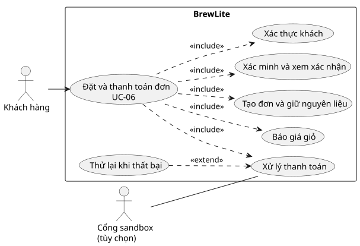

# UC-06 · Đặt và thanh toán đơn hàng

| Thuộc tính | Đặc tả |
| --- | --- |
| Actor chính | Khách hàng. |
| Actor hỗ trợ | Cổng thanh toán mô phỏng hoặc cổng sandbox nếu đã cấu hình. |
| Kích hoạt | Khách chọn thanh toán các dòng đã chọn trong giỏ. |
| Tiền điều kiện | Giỏ có ít nhất một dòng hợp lệ. Để gọi API đặt đơn và thanh toán, khách phải có JWT còn hiệu lực. |
| Hậu điều kiện thành công | Đơn thuộc khách, thanh toán chính `SUCCEEDED`, đơn đạt `PAID`, giữ kho chuyển `CONSUMED`. Web xác minh đơn và loại đúng các dòng đã mua. Khách có thể mở xác nhận và lịch sử. |
| Bảo đảm khi lỗi | Không tạo thêm đơn hoặc thanh toán khi replay cùng key và payload. Giỏ được giữ nếu chưa xác nhận thành công. Thanh toán thất bại trả kho và lượt khuyến mãi. |
| Mã yêu cầu | FR-05–07, FR-09–18, FR-22 và NFR-04/05/12. |

## Luồng chính

1. Khách chọn dòng giỏ, đăng nhập nếu cần, rồi yêu cầu báo giá. API kiểm tra JWT, dữ liệu và tính giá/khuyến mãi.
2. Khách xác nhận đặt. Web gửi `POST /api/orders` với `Idempotency-Key`; API tạo đơn `PENDING`, lưu snapshot và giữ kho trong một transaction.
3. Web đọc đơn. Nếu tổng tiền khớp báo giá, khách chọn Ví hoặc Thẻ mô phỏng và kịch bản thành công.
4. Web gửi `POST /api/payments` với key riêng. API xác minh chủ đơn, tổng tiền và trạng thái, ghi giao dịch thành công và chuyển đơn sang `PAID`.
5. Web đọc trạng thái mới từ API, hiển thị xác nhận và cập nhật giỏ. Khách mở lịch sử để theo dõi pha chế.

## Luồng thay thế và ngoại lệ

| Điều kiện | Hành vi |
| --- | --- |
| Chưa đăng nhập hoặc JWT hết hạn | Điều hướng đăng nhập và giữ giỏ. Với request đang chờ xác minh, giữ nguyên thông tin cần để khôi phục sau đăng nhập. |
| Mã giảm giá không hợp lệ hoặc hết lượt | Hiện lỗi từ quote/tạo đơn và cho khách sửa hoặc bỏ mã. |
| Giá đã thay đổi | Hiện tổng tiền đã lưu trên đơn và yêu cầu xác nhận giá mới trước khi gọi thanh toán; khách cũng có thể hủy. |
| Hết nguyên liệu hoặc tranh tồn kho | API từ chối nếu không giữ đủ kho. Không lưu đơn dở dang. Khách sửa giỏ và thử lại. |
| Thanh toán mô phỏng thất bại | Đơn thành `PAYMENT_FAILED`, trả kho và lượt mã. Khách có thể thử lại trên cùng đơn bằng key thanh toán mới; API kiểm tra và giữ kho lại. |
| Mất kết nối hoặc gửi lại | Giữ key và payload cũ cho yêu cầu có kết quả chưa rõ. Replay cùng payload trả kết quả đã ghi. Khác payload với cùng key trả lỗi xung đột. Web xác minh trạng thái mới trước khi cập nhật giỏ. |
| Sandbox báo thành công muộn sau khi trả kho | API ghi giao dịch và cảnh báo đối soát, giữ đơn đã hủy và kho đã trả. |

## Các use-case thành phần

| Mã | Điểm vào và kết quả |
| --- | --- |
| UC-05 | Nếu thiếu JWT hợp lệ, khách đăng nhập và quay lại luồng đặt đơn với giỏ còn nguyên. |
| UC-06.1 | Khách xác nhận báo giá. Hệ thống tạo đơn PENDING với snapshot giá và mã đơn. |
| UC-06.2 | Trong transaction tạo đơn, hệ thống quy đổi số lượng nguyên liệu theo size/topping và giữ kho theo version. |
| UC-06.3 | Khách thanh toán Ví/Thẻ mô phỏng. Hệ thống xử lý SUCCESS/FAIL và xác minh trạng thái đơn trước khi cập nhật giỏ. |
| UC-07 | Nếu có mã ưu đãi, API báo giá kiểm tra điều kiện. Khi tạo đơn, giữ lượt trong cùng transaction với kho. |

Hợp đồng ở [OpenAPI](../api/openapi.yaml). Activity và sequence sẽ được đối chiếu với UC-06 ở Task 2.
